# Supervised Learning Tasks

Supervised Learning is mainly divided into two tasks:

1. **Classification** — Predict discrete classes or categories.
2. **Regression** — Predict continuous numerical values.

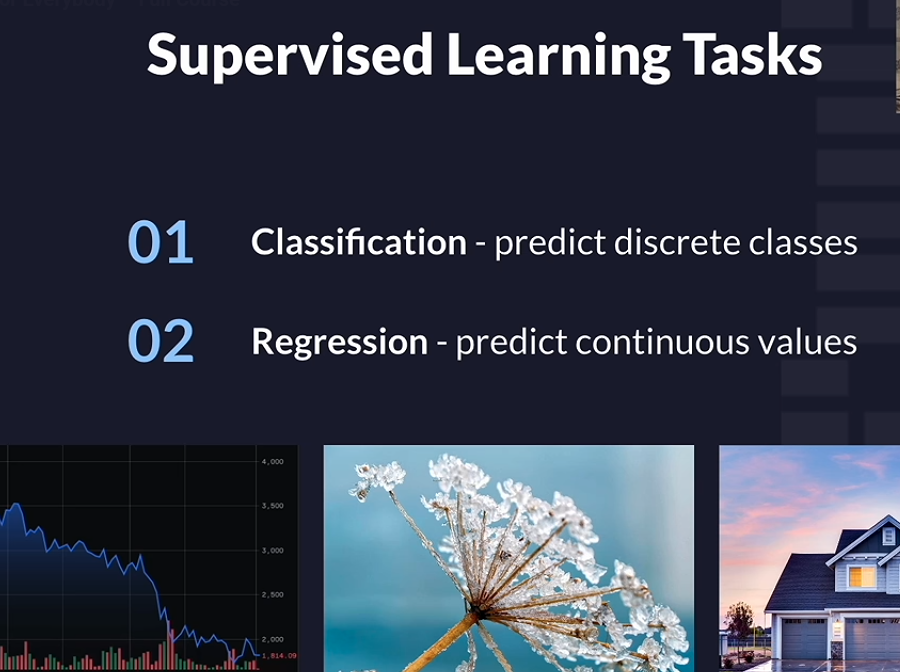

## 1. Classification

**Classification** is a supervised learning task in which a model predicts a discrete class or category based on input features.

The target variable represents a class label rather than a continuous numerical quantity.

### Examples

- Email → Spam or Not Spam
- Image → Cat, Dog, or Horse
- Transaction → Fraudulent or Legitimate
- Student → Pass or Fail

Classification can be divided into binary classification and multiclass classification, depending on the number of possible classes.

## 2. Regression

**Regression** is a supervised learning task in which a model predicts a numerical value by learning the relationship between input features and a continuous target variable.

### Examples

- House features → Predicted house price
- Historical data → Predicted temperature
- Employee information → Predicted salary
- Vehicle features → Predicted car price

Unlike classification, regression predicts a numerical quantity rather than selecting a class label.

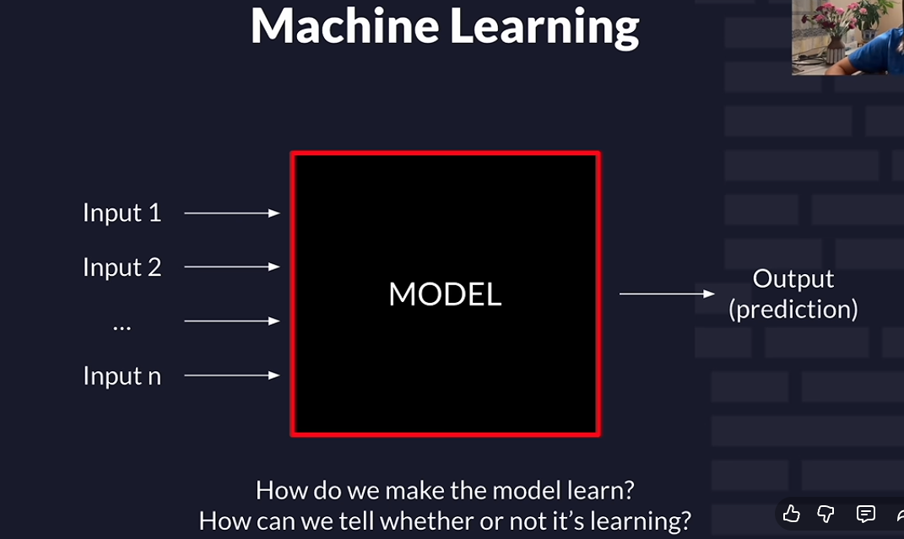

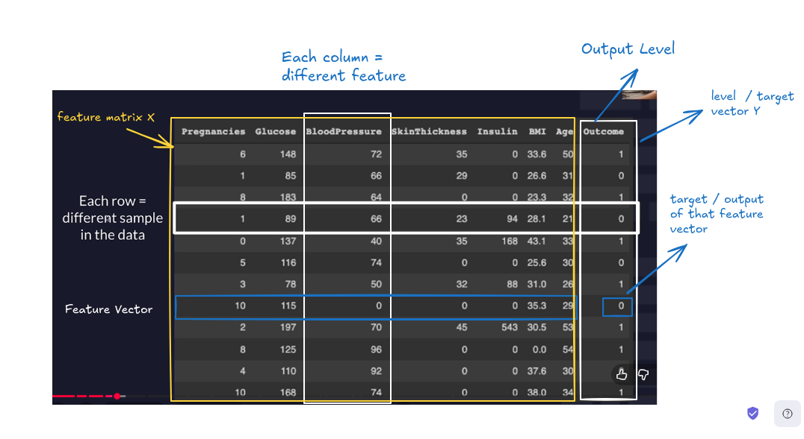

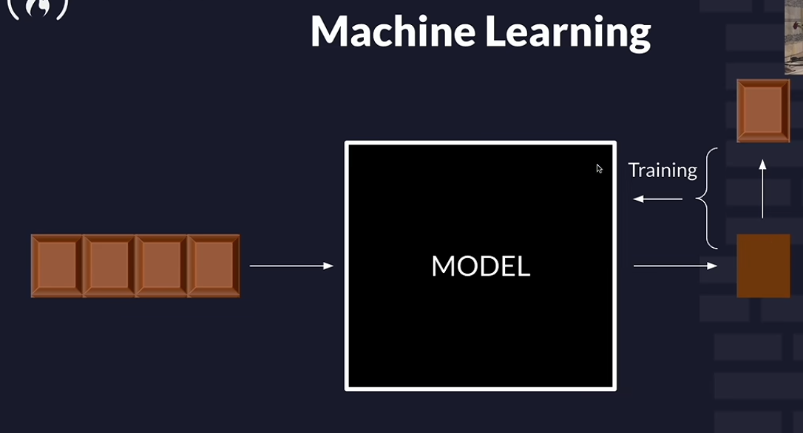

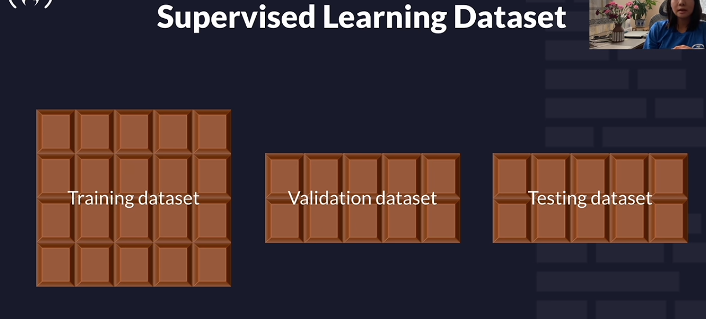

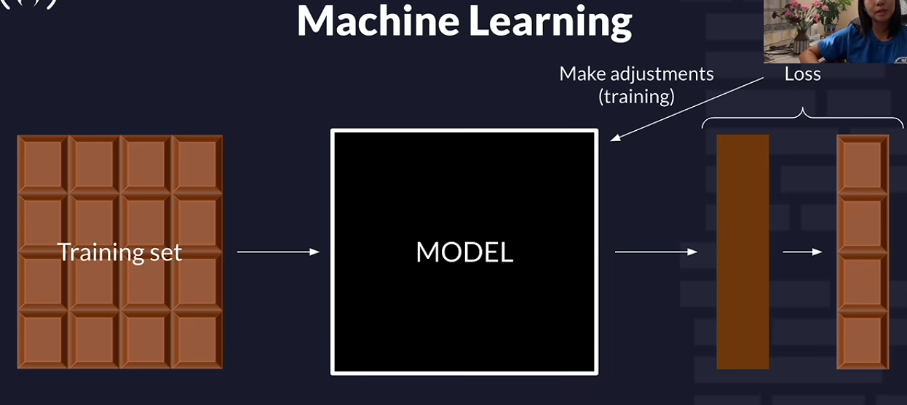

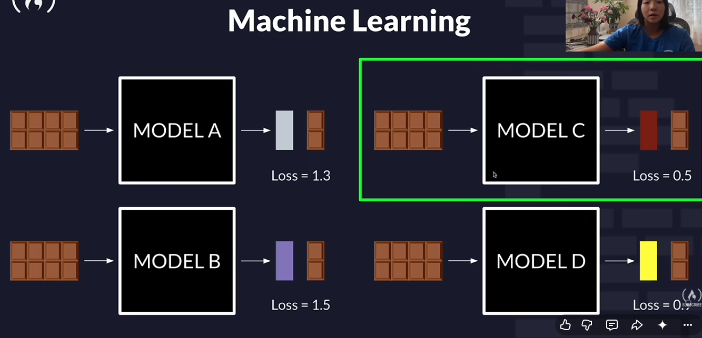

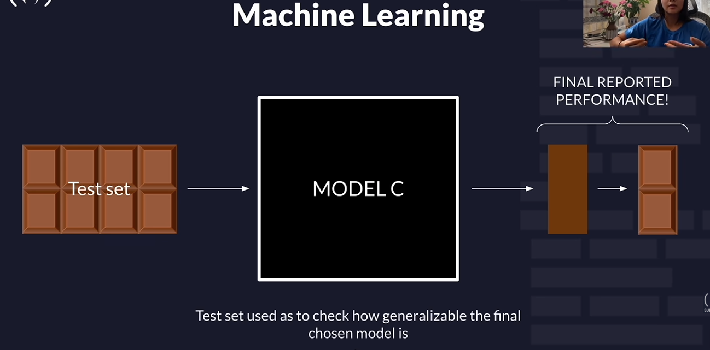

---

# Loss Function

A **loss function** measures how far a model's prediction is from the actual target value for a particular observation.

It provides a numerical measure of prediction error and helps the model learn during training.

The training process generally attempts to minimize the loss function by adjusting the model's parameters.

## Actual Value vs Predicted Value

Let:

- \(y\) = Actual value
- \(\hat{y}\) = Predicted value

The prediction error, also called the residual in regression, is:

\[
e = y - \hat{y}
\]

For example, suppose a model predicts a house price:

```text
Actual Price    = 100
Predicted Price = 90

Error = 100 - 90 = 10
```

The loss function converts the prediction error into a measure that can be optimized during training.

## Mean Squared Error (MSE)

**Mean Squared Error (MSE)** is a commonly used loss function for regression. It calculates the average of the squared differences between actual and predicted values.

\[
\operatorname{MSE} =
\frac{1}{n}\sum_{i=1}^{n}(y_i-\hat{y}_i)^2
\]

Where:

- \(n\) = Number of observations
- \(y_i\) = Actual value of observation \(i\)
- \(\hat{y}_i\) = Predicted value of observation \(i\)

### Example

Suppose the actual and predicted values are:

| Actual | Predicted | Squared Error |
|---:|---:|---:|
| 10 | 8 | 4 |
| 20 | 22 | 4 |
| 30 | 27 | 9 |

\[
\operatorname{MSE} = \frac{4+4+9}{3}
= \frac{17}{3}
\approx 5.67
\]

A lower MSE indicates smaller squared prediction errors on the evaluated dataset.

Squaring the errors prevents positive and negative errors from canceling each other out and penalizes larger errors more heavily.

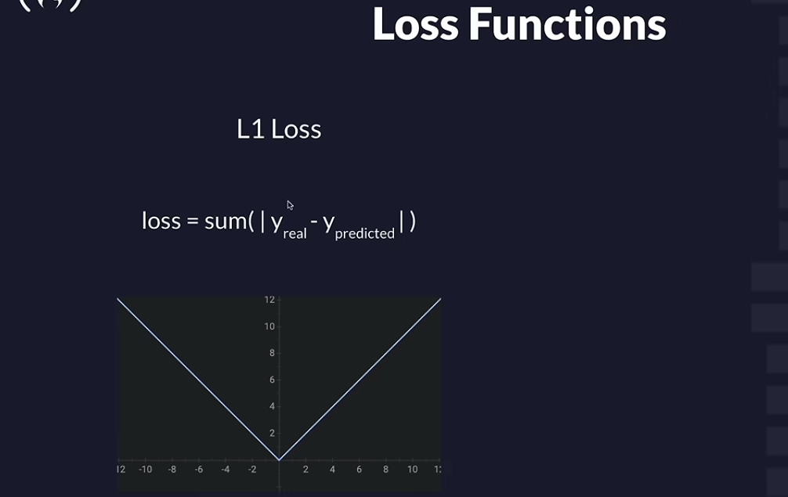

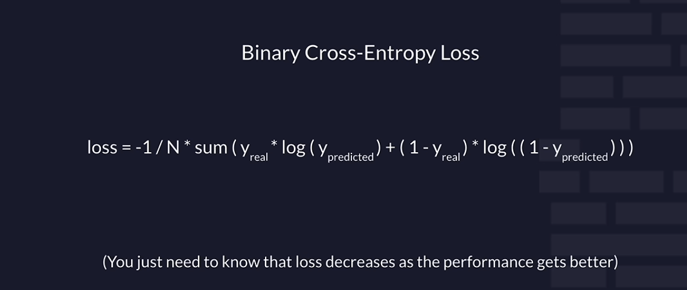

## Loss Function in Classification

Classification models also use loss functions, but their loss functions are designed for predicting class probabilities.

**Cross-Entropy Loss** is commonly used in classification.

For binary classification, binary cross-entropy is:

\[
L=-[y\log(p)+(1-y)\log(1-p)]
\]

Where:

- \(y\) = Actual binary label (0 or 1)
- \(p\) = Predicted probability of the positive class

The loss becomes larger when the model assigns a low probability to the correct class.

For example, if the actual label is `1`:

- Predicted probability of `0.95` → Low loss
- Predicted probability of `0.10` → High loss

The objective is to make the model assign higher probabilities to the correct classes.

---

# Accuracy

**Accuracy** is a classification evaluation metric that measures the proportion of predictions that are correct out of all evaluated predictions.

It is calculated as:

\[
\operatorname{Accuracy} =
\frac{\text{Number of Correct Predictions}}
{\text{Total Number of Predictions}}
\]

Alternatively, for binary classification:

\[
\operatorname{Accuracy} =
\frac{TP+TN}{TP+TN+FP+FN}
\]

Where:

- **TP (True Positive):** Positive cases correctly predicted as positive.
- **TN (True Negative):** Negative cases correctly predicted as negative.
- **FP (False Positive):** Negative cases incorrectly predicted as positive.
- **FN (False Negative):** Positive cases incorrectly predicted as negative.

## Example

Suppose a classification model makes 100 predictions, and 90 of them are correct.

\[
\operatorname{Accuracy}=\frac{90}{100}=0.90
\]

\[
\operatorname{Accuracy}=90\%
\]

The model has an accuracy of 90% on that evaluated dataset.

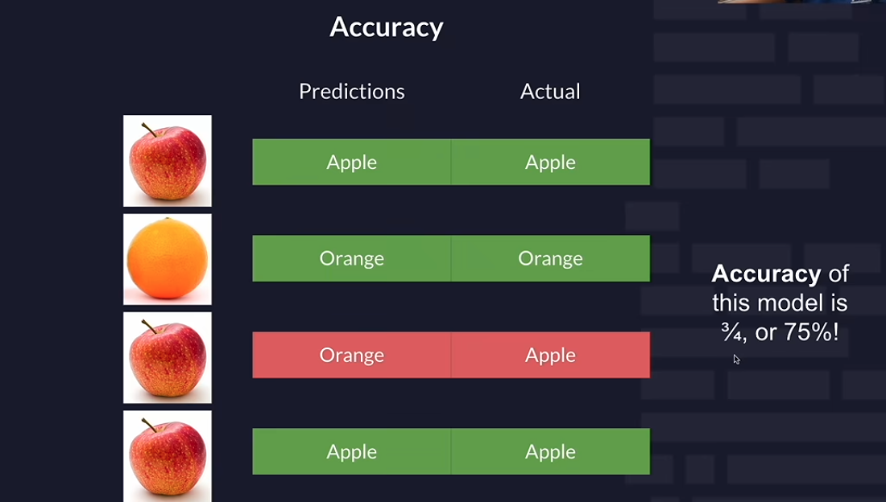

## Important Note

Accuracy alone may be misleading when the classes are imbalanced.

For example, suppose 95 out of 100 transactions are legitimate and only 5 are fraudulent. A model that predicts every transaction as legitimate achieves 95% accuracy but fails to identify any fraudulent transactions.

In such cases, metrics such as **precision, recall, and F1-score** can provide additional insight into classification performance.
