# Classification: Metrics and Classic Models

> **What this note covers:** first, *how to tell whether a classifier is good* (metrics). Then four classic classifiers — **KNN, Naive Bayes, Logistic Regression, SVM**.
>
> Each algorithm follows the same pattern:
> **Simple definition → What problem it solves → How it works → The math → Worked example → When to use it**
>
> Full derivations are in the collapsible **"Deeper math"** blocks.

## Contents

1. [Evaluating a classifier](#1-evaluating-a-classifier)
2. [K-Nearest Neighbours (KNN)](#2-k-nearest-neighbours-knn)
3. [Naive Bayes](#3-naive-bayes)
4. [Logistic Regression](#4-logistic-regression)
5. [Support Vector Machines (SVM)](#5-support-vector-machines-svm)
6. [Which model should I use?](#6-which-model-should-i-use)

---

## 1. Evaluating a classifier

**Simple definition:** a classifier makes yes/no (or A/B/C) decisions. To judge it, we count **which kinds of mistakes** it makes, not only how many, because different mistakes have different costs. Missing a cancer case is far worse than a false alarm. Deleting a real email is worse than letting one spam message through.

### 1.1 The confusion matrix: where everything starts

Every prediction lands in one of four boxes:

|                     | **Model says YES** | **Model says NO** |
|---|---|---|
| **Truly YES**       | **TP** — true positive (caught it) | **FN** — false negative (missed it) |
| **Truly NO**        | **FP** — false positive (false alarm) | **TN** — true negative (correctly ignored) |

**Running example — a fraud detector checks 1,000 transactions** (50 are really fraud):

|                     | **Flagged as fraud** | **Passed as legit** | **Total** |
|---|---:|---:|---:|
| **Really fraud**    | TP = 40 | FN = 10 | 50 |
| **Really legit**    | FP = 20 | TN = 930 | 950 |

In words: the model raised 60 alarms and 40 were real. It missed 10 frauds.

### 1.2 The core metrics

| Metric | Plain-English question | Formula | Fraud example |
|---|---|---|---:|
| **Accuracy** | How often is the model right overall? | $\frac{TP+TN}{\text{all}}$ | $\frac{970}{1000} = 0.97$ |
| **Precision** | When it raises an alarm, how often is it real? | $\frac{TP}{TP+FP}$ | $\frac{40}{60} = 0.67$ |
| **Recall** (sensitivity) | Of all the real cases, how many did it catch? | $\frac{TP}{TP+FN}$ | $\frac{40}{50} = 0.80$ |
| **Specificity** | Of all the normal cases, how many did it leave alone? | $\frac{TN}{TN+FP}$ | $\frac{930}{950} = 0.98$ |
| **F1 score** | One number that balances precision and recall | $\frac{2 \cdot P \cdot R}{P + R}$ | $0.73$ |

**A memory trick:**

- **Precision** = "how *pure* are my alarms?" It is hurt by false alarms (FP).
- **Recall** = "how *complete* is my catch?" It is hurt by misses (FN).

**Why F1 uses this odd formula (the harmonic mean):** it punishes imbalance. A model with precision 1.0 and recall 0.01 would score 0.505 on a simple average, which looks okay. Its F1 is 0.02, which is correctly terrible. You can't get a good F1 by being great at only one of the two.

**Two more rates you will see everywhere** (these are the axes of the ROC curve):

$$
\text{TPR} = \frac{TP}{TP+FN} = \frac{40}{50} = 0.80 \qquad \text{FPR} = \frac{FP}{FP+TN} = \frac{20}{950} = 0.021
$$

TPR is just recall. FPR is the share of normal cases that get falsely flagged, and it equals $1 - \text{specificity}$.

F1 can also be written directly in counts, which is quicker by hand:

$$
F_1 = \frac{2\,TP}{2\,TP + FP + FN} = \frac{80}{80 + 20 + 10} = \frac{80}{110} = 0.727
$$

### 1.3 The accuracy trap

Imagine a "model" that **always says legit** on the same data. It never flags anything.

| | Our model | Always-legit model |
|---|---:|---:|
| Accuracy | 0.97 | **0.95** |
| Recall | 0.80 | **0.00** |
| F1 | 0.73 | 0.00 |

The useless model gets 95% accuracy because 95% of transactions are legit anyway. **When one class is rare, accuracy mostly reflects the class ratio, not the model.** Always compare against this "dumb baseline".

### 1.4 The threshold: one model, many behaviours

Most classifiers output a **score** such as "0.83 chance of fraud". You choose a **threshold**: above it, say YES.

Formally, with predicted probability $p$ and threshold $t$: predict $\hat{y} = 1$ if $p \ge t$, otherwise $\hat{y} = 0$.

Lowering $t$ moves samples across the line. Positives move from FN to TP, so recall goes up. Negatives move from TN to FP, so false alarms go up.

- **High threshold** (e.g. 0.9): few alarms, each very trustworthy → **high precision, low recall**.
- **Low threshold** (e.g. 0.2): lots of alarms, catches almost everything → **high recall, low precision**.

Example: 10 samples sorted by score (1 = really positive):

| Score | 0.95 | 0.90 | 0.80 | 0.70 | 0.60 | 0.55 | 0.40 | 0.30 | 0.20 | 0.10 |
|---|---|---|---|---|---|---|---|---|---|---|
| **True label** | 1 | 1 | 0 | 1 | 1 | 0 | 0 | 1 | 0 | 0 |

| Threshold | Alarms raised | Correct alarms | Precision | Recall | F1 |
|---:|---:|---:|---:|---:|---:|
| 0.90 | 2 | 2 | 1.00 | 0.40 | 0.57 |
| 0.70 | 4 | 3 | 0.75 | 0.60 | 0.67 |
| **0.60** | **5** | **4** | **0.80** | **0.80** | **0.80** ← best balance |
| 0.30 | 8 | 5 | 0.63 | 1.00 | 0.77 |
| 0.10 | 10 | 5 | 0.50 | 1.00 | 0.67 |

> **Key lesson:** 0.5 is not a magic threshold. Pick it on validation data based on what each mistake costs your business.

### 1.5 ROC curve and AUC: judging the model across all thresholds

**ROC curve:** try every threshold and plot *"how many real cases I catch"* (recall) against *"how many normal cases I falsely flag"* (false positive rate).

**AUC** (Area Under that Curve) is a single number from 0.5 to 1.0:

> **AUC = the probability that the model gives a random positive a higher score than a random negative.**

- 1.0 = perfect ranking. 0.5 = coin flip.
- In the 10-sample example: of the 5 × 5 = 25 (positive, negative) pairs, 20 are ranked correctly → **AUC = 20/25 = 0.80**.

As a formula, with $P$ positives, $N$ negatives and scores $s$:

$$
\text{AUC} = \frac{1}{P \cdot N}\sum_{i \in \text{pos}}\ \sum_{j \in \text{neg}} \mathbb{1}\big[s_i > s_j\big]
$$

Here $\mathbb{1}[\cdot]$ is 1 when the condition is true and 0 otherwise. The 5 wrongly ordered pairs are: negative 0.80 above positives 0.70, 0.60 and 0.30; negative 0.55 above 0.30; negative 0.40 above 0.30.

The same number comes out as the geometric area under the ROC curve. The curve steps through (FPR, TPR) = (0, 0.4), (0.2, 0.8), (0.6, 1.0), giving three rectangles:

$$
\text{AUC} = (0.2 \times 0.4) + (0.4 \times 0.8) + (0.4 \times 1.0) = 0.08 + 0.32 + 0.40 = 0.80
$$

**PR curve:** plots precision against recall. Its summary number is **Average Precision (AP)**, here 0.835.

AP adds up the precision at each point where recall increases, weighted by how much recall increased:

$$
\text{AP} = \sum_k (R_k - R_{k-1})\,P_k = 0.2(1.0) + 0.2(1.0) + 0.2(0.75) + 0.2(0.80) + 0.2(0.625) = 0.835
$$

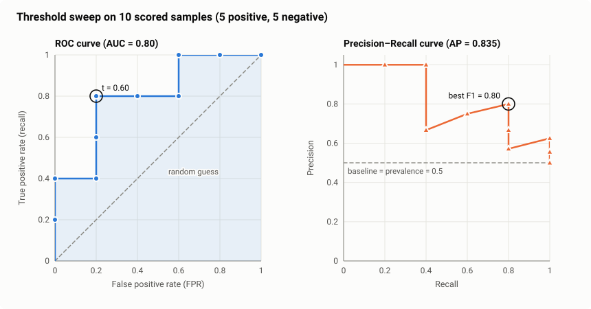

**Which one should I look at?**

| Situation | Use |
|---|---|
| Classes are roughly balanced | ROC-AUC |
| Positives are **rare** (fraud, disease, search results) | **PR curve / AP**. ROC looks too optimistic here. |
| Telling a product team what to expect | Precision and recall **at your chosen threshold** |

### 1.6 Rare positives make precision collapse

The same model can look great or terrible depending on **how rare the positive class is**. Take our fraud model (catches 80% of fraud, falsely flags 2.1% of legit) on 100,000 transactions:

| Fraud rate | Real frauds caught | False alarms | **Precision** |
|---:|---:|---:|---:|
| 50% | 40,000 | 1,053 | **0.97** |
| 5% | 4,000 | 2,000 | **0.67** |
| 0.5% | 400 | 2,095 | **0.16** |

This follows directly from Bayes' rule. With prevalence $\pi$ (the fraction of real positives):

$$
\text{Precision} = \frac{\text{TPR}\cdot\pi}{\text{TPR}\cdot\pi + \text{FPR}\cdot(1-\pi)}
$$

At $\pi = 0.005$:

$$
\text{Precision} = \frac{0.80 \times 0.005}{0.80 \times 0.005 + 0.021 \times 0.995} = \frac{0.0040}{0.0040 + 0.0209} = 0.16
$$

TPR and FPR don't depend on $\pi$, but precision does. As $\pi$ shrinks, the FPR term dominates the denominator.

Same model, but at 0.5% fraud, **84% of alarms are false**. When the thing you're looking for is rare, even a small false-alarm rate produces a flood of false alarms.

> **Practical warning:** if your test set has a different class balance from real-world traffic, your precision and F1 will not hold up in production.

### 1.7 More than two classes

Compute precision, recall and F1 **for each class separately**, then average:

The confusion matrix becomes $K \times K$. Example with three classes (rows = actual, columns = predicted):

| Actual \ Predicted | cat | dog | rabbit | Row total |
|---|---:|---:|---:|---:|
| **cat** | **45** | 3 | 2 | 50 |
| **dog** | 8 | **30** | 2 | 40 |
| **rabbit** | 2 | 3 | **5** | 10 |
| Column total | 55 | 36 | 9 | 100 |

For class $k$, treat it as "class $k$ vs everything else":

$$
\text{Precision}_k = \frac{\text{diagonal}_k}{\text{column total}_k} \qquad \text{Recall}_k = \frac{\text{diagonal}_k}{\text{row total}_k}
$$

For example, $\text{Precision}_{\text{cat}} = 45/55 = 0.82$ and $\text{Recall}_{\text{cat}} = 45/50 = 0.90$.

| Class | Precision | Recall | F1 |
|---|---:|---:|---:|
| cat (50 samples) | 0.82 | 0.90 | 0.86 |
| dog (40 samples) | 0.83 | 0.75 | 0.79 |
| rabbit (10 samples) | 0.56 | 0.50 | **0.53** |

| Average | How | Result | Use when |
|---|---|---:|---|
| **Macro** | simple mean, every class counts equally | 0.72 | small classes matter (exposes the weak rabbit class) |
| **Weighted** | mean weighted by class size | 0.80 | you care about overall performance |

$$
\text{Macro-F1} = \frac{1}{K}\sum_{k=1}^{K} F1_k = \frac{0.857 + 0.789 + 0.526}{3} = 0.724
$$

$$
\text{Weighted-F1} = \sum_{k=1}^{K} \frac{n_k}{n}\,F1_k = \frac{50(0.857) + 40(0.789) + 10(0.526)}{100} = 0.797
$$

Here $n_k$ is the number of samples in class $k$.

### 1.8 Cheat sheet: which metric?

| If the expensive mistake is… | Focus on |
|---|---|
| **Missing** a positive (cancer, fraud, safety) | **Recall** |
| **False alarms** (spam filter deleting real mail) | **Precision** |
| Both matter and positives are rare | **F1**, **PR-AUC** |
| Comparing models in general | **ROC-AUC** |
| You'll use the probabilities themselves | **Log loss** (see below) |
| Multiclass with small classes | **Macro-F1** and the per-class report |

<b>Deeper math: F-beta, MCC, log loss, calibration</b>

**F-beta** weights recall $\beta$ times as much as precision ($F_2$ favours recall, $F_{0.5}$ favours precision):

$$
F_\beta = (1+\beta^2)\frac{P \cdot R}{\beta^2 P + R}
$$

Fraud example: $F_2 = 0.769$, $F_{0.5} = 0.690$.

**Matthews Correlation Coefficient** uses all four cells and stays honest under class imbalance (range −1 to 1):

$$
\text{MCC} = \frac{TP\cdot TN - FP\cdot FN}{\sqrt{(TP+FP)(TP+FN)(TN+FP)(TN+FN)}} = \frac{37000}{51759} = 0.715
$$

For the always-legit model, MCC = 0.

**Log loss** (binary cross-entropy) judges the probabilities themselves:

$$
\mathcal{L} = -\frac{1}{n}\sum_{i}\Big[y_i\log p_i + (1-y_i)\log(1-p_i)\Big]
$$

| True label | Predicted $p$ | Loss |
|---:|---:|---:|
| 1 | 0.90 | 0.11 |
| 1 | 0.60 | 0.51 |
| 1 | 0.10 | 2.30 |
| 1 | 0.01 | 4.61 |

**Calibration:** among all samples where the model says 70%, about 70% should really be positive. Logistic regression is usually well calibrated. Naive Bayes and SVM are not; fix them with `CalibratedClassifierCV`.

**Micro-F1** pools all classes' TP/FP/FN together. For single-label multiclass problems it equals accuracy.

---

## 2. K-Nearest Neighbours (KNN)

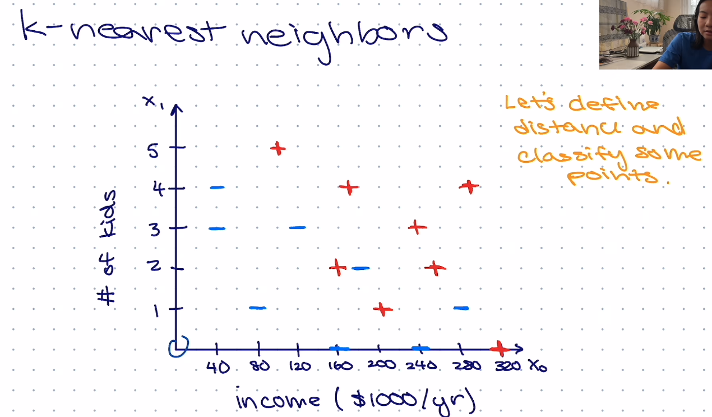

### Simple definition

**"Tell me who your neighbours are, and I'll tell you who you are."** To classify a new point, KNN finds the $k$ most similar examples it has seen and lets them vote.

### What problem it solves

You have labelled examples but no idea what the "rule" looks like. The boundary between classes might be curvy, patchy, or impossible to write as an equation. KNN makes **no assumptions about the shape**: it just trusts that similar inputs have similar labels.

Real uses: recommendation ("users similar to you liked…"), and **vector search in RAG systems**, which is KNN on text embeddings.

### How it works

1. **Store** all training data. There is no real training step.
2. A new point arrives: **measure its distance** to every stored point.
3. **Pick the $k$ closest.**
4. **Majority vote** decides the class (for regression, average their values).

### The math

The only formula you need is a distance. The usual one is **Euclidean distance**, the straight-line distance you know from school:

$$
d(\mathbf{a}, \mathbf{b}) = \sqrt{(a_1 - b_1)^2 + (a_2 - b_2)^2 + \dots}
$$

| Distance | Plain meaning | Use for |
|---|---|---|
| Euclidean | straight-line distance | default for numeric features |
| Manhattan | walk along a grid (sum of differences) | data with outliers |
| Cosine | do the vectors **point the same direction**? (ignores length) | text, embeddings |

Euclidean and Manhattan are both special cases of the **Minkowski distance**, with $p = 2$ and $p = 1$:

$$
d_p(\mathbf{a}, \mathbf{b}) = \Big(\sum_{j=1}^{d} \lvert a_j - b_j \rvert^p\Big)^{1/p}
$$

**Cosine similarity** measures the angle between two vectors:

$$
\cos\theta = \frac{\mathbf{a}\cdot\mathbf{b}}{\lVert\mathbf{a}\rVert\,\lVert\mathbf{b}\rVert} \qquad \text{cosine distance} = 1 - \cos\theta
$$

**The vote.** With $N_k(\mathbf{x})$ the set of $k$ nearest neighbours, KNN predicts the class with the most votes:

$$
\hat{y} = \arg\max_{c} \sum_{i \in N_k(\mathbf{x})} \mathbb{1}[y_i = c]
$$

**Distance-weighted vote.** Closer neighbours count more, with weight $w_i = 1/d_i$. In the raw-feature version of the worked example below, class − gets $1/10.05 = 0.100$ and class + gets $1/30.00 + 1/30.15 = 0.067$. The weighted vote picks **−**, even though the plain vote picks **+**.

### Worked example: the scaling trap

Data from the lecture: **income** (thousands of USD per year) and **number of kids**. New person: income 130, 2 kids. Use $k = 3$.

**Distance to a person with income 120 and 3 kids:**

$$
d = \sqrt{(120-130)^2 + (3-2)^2} = \sqrt{100 + 1} = 10.05
$$

The income difference contributes **100** and the kids difference only **1**. Income wins simply because its numbers are bigger, so the model basically ignores kids.

**Fix: standardise** each feature, meaning measure it in "how many standard deviations from average" ($z = \frac{x - \text{mean}}{\text{std}}$). After that, both features count fairly.

From the training data, income has mean 166.9 and std 83.4, and kids has mean 2.69 and std 1.26. The same distance in standardised units:

$$
d_z = \sqrt{\left(\frac{120-130}{83.4}\right)^2 + \left(\frac{3-2}{1.26}\right)^2} = \sqrt{0.120^2 + 0.791^2} = 0.80
$$

Now the one-kid difference (0.79) counts much more than the 10k income difference (0.12).

| | 3 nearest neighbours | Vote | Prediction |
|---|---|---|---|
| Raw numbers | (120,3) −, (160,2) +, (100,5) + | 2 vs 1 | **+** |
| Standardised | (160,2) +, (180,2) −, (120,3) − | 1 vs 2 | **−** |

**Same data, same $k$, opposite answer.** With raw numbers, someone with 5 kids counted as a "close neighbour" just because their income was similar.

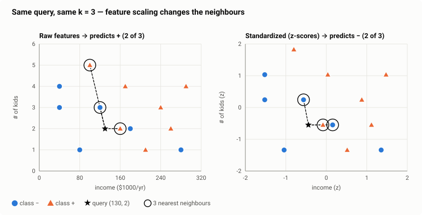

> **Rule:** always scale features for any distance-based method (KNN, SVM, K-means). Use `StandardScaler` inside a `Pipeline`.

### Choosing $k$

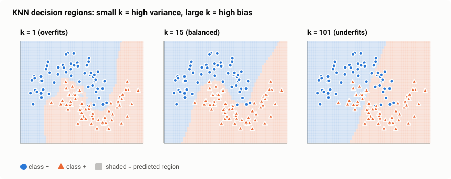

| $k$ | What happens | Problem name |
|---|---|---|
| Too small (1) | Follows every noisy point; jagged, island-like regions | **Overfitting** |
| Just right (≈ 5–25) | Smooth boundary that follows the real pattern | Good fit |
| Too large | Almost always predicts the majority class | **Underfitting** |

Choose $k$ with cross-validation. Use an odd $k$ for two classes so votes can't tie.

### Weakness: the curse of dimensionality

With many features (hundreds or more), **all points become roughly equally far apart**, so "nearest" stops meaning "similar". In a simulation with 500 random points: with 2 features, the farthest point was about 36× farther away than the nearest; with 1,000 features it was only 13% farther.

Another way to see it: suppose data is spread evenly inside a unit cube with $d$ features. A smaller cube that holds a fraction $r$ of the data must have edge length

$$
\text{edge} = r^{1/d}
$$

To capture just 1% of the data ($r = 0.01$): with $d = 2$ the edge is $0.01^{1/2} = 0.10$, which is local. With $d = 10$ it is $0.01^{1/10} = 0.63$. With $d = 100$ it is $0.955$, which spans almost the whole range of every feature, so the "neighbourhood" is no longer local.

Embeddings still work with KNN because real data occupies only a small, structured part of that huge space.

### When to use it

| Good for | Bad for |
|---|---|
| Small–medium datasets, irregular boundaries | Huge datasets (each prediction scans all data) |
| Similarity search, recommendations, embeddings | Many irrelevant features |
| Quick baseline, easy to explain ("these 5 similar cases…") | Unscaled data |

Each prediction computes $n$ distances in $d$ dimensions, which costs $O(nd)$. For millions of points, vector databases use **approximate** nearest-neighbour search (HNSW, FAISS), which is much faster at a tiny loss in accuracy.

---

## 3. Naive Bayes

### Simple definition

**A probability-based detective.** For each class, it asks: *"If this email were spam, how likely is it to contain these exact words?"* Whichever class makes the evidence most likely wins.

### What problem it solves

You need a classifier that is **fast, simple, and works with very little data**, especially for **text** (spam filtering, sentiment, topic tagging). Naive Bayes trains in a single pass over the data, simply by counting.

### How it works

1. **Count** how often each feature (e.g., each word) appears in each class during training.
2. Turn the counts into probabilities: $P(\text{word} \mid \text{class})$.
3. For a new item, **multiply** the probabilities of its words for each class, times how common that class is.
4. Pick the class with the **highest score**.

### Why "naive"?

It assumes every word is **independent** of the others once you know the class. That is obviously false ("New" and "York" go together), but it makes the math very simple, and the classifier still picks the right class surprisingly often.

### The math

Bayes' rule, specialised for classification:

$$
\text{score}(\text{class}) = P(\text{class}) \times P(\text{word}_1 \mid \text{class}) \times P(\text{word}_2 \mid \text{class}) \times \dots
$$

In words: **how common the class is × how well each word fits that class.**

**Where this comes from.** Bayes' rule gives the probability of a class $C$ after seeing features $\mathbf{x} = (x_1, \dots, x_d)$:

$$
P(C \mid \mathbf{x}) = \frac{P(\mathbf{x} \mid C)\,P(C)}{P(\mathbf{x})}
$$

| Term | Name | Meaning |
|---|---|---|
| $P(C)$ | prior | how common the class is before looking at the data |
| $P(\mathbf{x} \mid C)$ | likelihood | how typical these features are for the class |
| $P(\mathbf{x})$ | evidence | the same for every class, so it can be dropped when comparing classes |
| $P(C \mid \mathbf{x})$ | posterior | what we want: the class probability given the data |

Estimating $P(x_1, \dots, x_d \mid C)$ directly is impossible with realistic data, because every combination of features would need its own count. The naive independence assumption splits it into one-dimensional pieces:

$$
P(\mathbf{x} \mid C) = \prod_{j=1}^{d} P(x_j \mid C)
\qquad\Rightarrow\qquad
\hat{y} = \arg\max_{C}\; P(C)\prod_{j=1}^{d} P(x_j \mid C)
$$

### Worked example: a spam filter

| Class | Training emails |
|---|---|
| Spam | "win money now", "win prize money", "claim your prize now" |
| Ham (not spam) | "meeting at noon", "project meeting now", "send the project money report" |

Classify the message **"win money meeting"**.

**Problem:** "meeting" never appears in spam, so its probability would be 0, and one zero wipes out the whole product. **Fix — Laplace smoothing:** add 1 to every count, so nothing is ever exactly 0.

$$
P(\text{word} \mid \text{class}) = \frac{\text{count of word in class} + 1}{\text{total words in class} + \text{vocabulary size}}
$$

Spam has 10 words, ham has 11, and the vocabulary has 13 distinct words:

| Word | Seen in spam | $P(\cdot \mid \text{spam})$ | Seen in ham | $P(\cdot \mid \text{ham})$ |
|---|---:|---:|---:|---:|
| win | 2 | 3/23 | 0 | 1/24 |
| money | 2 | 3/23 | 1 | 2/24 |
| meeting | 0 | 1/23 | 2 | 3/24 |

Both classes have 3 of the 6 emails, so the prior is 0.5 each:

$$
\text{spam score} = 0.5 \times \tfrac{3}{23} \times \tfrac{3}{23} \times \tfrac{1}{23} = 0.000370
$$

$$
\text{ham score} = 0.5 \times \tfrac{1}{24} \times \tfrac{2}{24} \times \tfrac{3}{24} = 0.000217
$$

Convert to a probability: $\frac{0.000370}{0.000370 + 0.000217} = 0.63$, so the message is **63% spam → classified as spam**. "win" and "money" outweighed "meeting".

> **Engineering tip:** with thousands of words, multiplying tiny numbers underflows to 0. Real implementations **add logarithms** instead of multiplying probabilities. Same answer, no underflow.

$$
\log \text{score}(C) = \log P(C) + \sum_{j} \log P(x_j \mid C)
$$

For the example:

$$
\text{spam: } \ln 0.5 + 2\ln\tfrac{3}{23} + \ln\tfrac{1}{23} = -7.90 \qquad \text{ham: } \ln 0.5 + \ln\tfrac{1}{24} + \ln\tfrac{2}{24} + \ln\tfrac{3}{24} = -8.44
$$

Spam has the larger (less negative) score, so it wins again.

### Variants

| Variant | Use for |
|---|---|
| **Multinomial NB** | word counts / TF-IDF (text) |
| **Bernoulli NB** | word present or absent (short texts) |
| **Gaussian NB** | continuous numeric features (assumes a bell curve per class) |

For **Gaussian NB**, each feature in each class is modelled as a bell curve with its own mean $\mu$ and variance $\sigma^2$, both estimated from the training data:

$$
P(x_j \mid C) = \frac{1}{\sqrt{2\pi\sigma_{C,j}^2}}\exp\!\left(-\frac{(x_j - \mu_{C,j})^2}{2\sigma_{C,j}^2}\right)
$$

Example: if spam emails contain on average $\mu = 8$ links with $\sigma = 2$, then an email with 10 links has likelihood $\frac{1}{\sqrt{2\pi \cdot 4}}\,e^{-4/8} = 0.199 \times 0.607 = 0.121$ under the spam class.

### When to use it

| Good for | Bad for |
|---|---|
| Text classification, especially with little data | When you need trustworthy probabilities (they're overconfident) |
| Very fast training and prediction | Features that interact (e.g., XOR patterns) |
| A strong first baseline | Large datasets where better models are affordable |

---

## 4. Logistic Regression

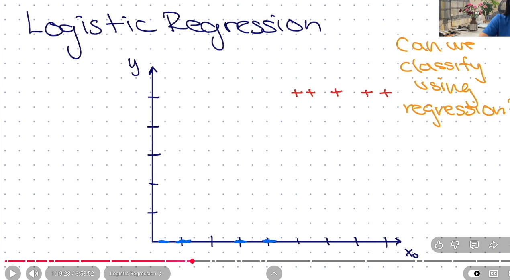

### Simple definition

Despite the name, logistic regression is a **classifier**. It computes a weighted score from the features, like linear regression, then **squashes that score into a probability between 0 and 1**.

### What problem it solves

We want a model that answers **"what is the probability this is a YES?"**, gives **interpretable** results ("each extra hour of study triples the odds of passing"), and is fast and reliable. It is the **default first model** for almost every classification problem.

### Why not just use linear regression?

The lecture's question: *"Can we classify using regression?"* Fit a straight line to 0/1 labels and cut at 0.5. Two problems:

1. The line goes **below 0 and above 1**, which can't be a probability.
2. **One very easy example far away tilts the whole line.** In the figure, adding one obvious "pass" student at x = 30 moves the cut-off from 3.5 to 4.5, and a correct prediction becomes wrong.

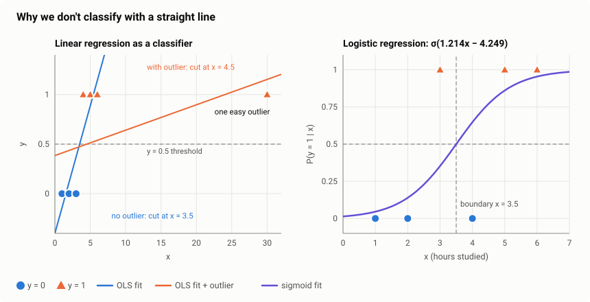

The S-shaped **sigmoid** fixes both: it stays between 0 and 1, and it flattens out far away, so easy points stop pulling on it.

### How it works

1. **Score:** compute a weighted sum of the features, $z = w_1x_1 + w_2x_2 + \dots + b$.
2. **Squash:** convert the score to a probability with the sigmoid, $p = \sigma(z)$.
3. **Decide:** if $p \ge 0.5$ (or your chosen threshold), predict YES.
4. **Learn:** compare $p$ with the true label and nudge the weights to reduce the error. Repeat many times (gradient descent).

### The math

**The sigmoid** turns any number into a probability:

$$
\sigma(z) = \frac{1}{1 + e^{-z}}
$$

| Score $z$ | −4 | −2 | 0 | 2 | 4 |
|---|---:|---:|---:|---:|---:|
| Probability $\sigma(z)$ | 0.02 | 0.12 | **0.50** | 0.88 | 0.98 |

A big positive score means "very likely YES", a big negative score means "very likely NO", and 0 means "50/50".

**Decision boundary:** $p = 0.5$ exactly when $z = 0$. So the boundary is the line (or plane) $w_1x_1 + w_2x_2 + \dots + b = 0$. **Logistic regression draws a straight-line boundary.**

**Log-odds: what the weights really mean.** Solve the sigmoid for $z$:

$$
p = \frac{1}{1+e^{-z}} \;\Rightarrow\; \frac{p}{1-p} = e^{z} \;\Rightarrow\; \log\frac{p}{1-p} = z = w_1x_1 + \dots + b
$$

$\frac{p}{1-p}$ is the **odds**: $p = 0.8$ gives odds of 4, or "4 to 1". So logistic regression is a **linear model of the log-odds**. Increase $x_1$ by 1 and $z$ grows by $w_1$, so the odds get multiplied by $e^{w_1}$:

$$
\frac{\text{odds}(x_1 + 1)}{\text{odds}(x_1)} = \frac{e^{z + w_1}}{e^{z}} = e^{w_1}
$$

**Loss — how wrong is the model?** It uses **cross-entropy** (log loss). The idea: being confidently wrong is punished very heavily.

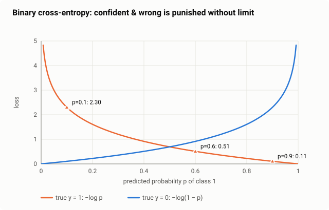

If the truth is YES and the model says $p = 0.9$, the loss is small (0.11). If it says $p = 0.1$, the loss is large (2.30).

Written out for one example with true label $y \in \{0, 1\}$:

$$
\ell(y, p) = -\big[\,y\log p + (1-y)\log(1-p)\,\big]
$$

Only one term is active at a time: if $y = 1$ the loss is $-\log p$; if $y = 0$ it is $-\log(1-p)$. Training minimises the average of $\ell$ over all $n$ examples.

**Learning rule:** the update is surprisingly simple:

$$
\text{weight} \leftarrow \text{weight} - \text{learning rate} \times (\underbrace{p - y}_{\text{error}}) \times x
$$

In words: **if the model over-predicted, lower the weights of the features that were active; if it under-predicted, raise them.** The same rule trains the output layer of neural networks.

In vector form, averaged over all $n$ examples, with learning rate $\eta$:

$$
\mathbf{w} \leftarrow \mathbf{w} - \eta \cdot \frac{1}{n}\sum_{i=1}^{n}(p_i - y_i)\,\mathbf{x}_i
\qquad
b \leftarrow b - \eta \cdot \frac{1}{n}\sum_{i=1}^{n}(p_i - y_i)
$$

### Worked example: hours studied → pass or fail

| Hours studied ($x$) | 1 | 2 | 3 | 4 | 5 | 6 |
|---|---|---|---|---|---|---|
| Passed ($y$) | 0 | 0 | 1 | 0 | 1 | 1 |

**The first training step by hand.** Start with $w = 0$, $b = 0$ and learning rate $\eta = 0.5$. Every score is $z = 0$, so every $p_i = 0.5$ and the loss is $-\ln 0.5 = 0.693$.

| $x_i$ | 1 | 2 | 3 | 4 | 5 | 6 | Sum |
|---|---:|---:|---:|---:|---:|---:|---:|
| error $p_i - y_i$ | 0.5 | 0.5 | −0.5 | 0.5 | −0.5 | −0.5 | 0 |
| error × $x_i$ | 0.5 | 1.0 | −1.5 | 2.0 | −2.5 | −3.0 | −3.5 |

$$
w \leftarrow 0 - 0.5 \times \frac{-3.5}{6} = 0.29 \qquad b \leftarrow 0 - 0.5 \times \frac{0}{6} = 0
$$

The loss drops to 0.672. Repeating this until the weights stop changing gives $w = 1.214$, $b = -4.249$:

$$
P(\text{pass}) = \sigma(1.214 \times \text{hours} - 4.249)
$$

| Question | Answer |
|---|---|
| Probability of passing with 2 hours? | $\sigma(1.214 \cdot 2 - 4.249) = \sigma(-1.82) = $ **0.14** |
| Probability of passing with 5 hours? | $\sigma(1.214 \cdot 5 - 4.249) = \sigma(1.82) = $ **0.86** |
| Where is the boundary? | $z = 0 \Rightarrow$ hours $= 4.249 / 1.214 = $ **3.5 hours** |
| What does $w = 1.214$ mean? | $e^{1.214} = 3.37$: **each extra hour multiplies the odds of passing by about 3.4** |

That last row is why logistic regression is popular in medicine, finance and the social sciences: every weight has a clear real-world meaning.

### Regularisation (preventing overfitting)

Add a penalty for large weights so the model doesn't over-trust any one feature:

$$
J_{\text{L2}} = \text{log loss} + \lambda \sum_j w_j^2 \qquad J_{\text{L1}} = \text{log loss} + \lambda \sum_j \lvert w_j \rvert
$$

$\lambda$ sets the strength of the penalty.

- **L2 (default):** shrinks all weights a little. Stable.
- **L1:** pushes unimportant weights to exactly 0, which works as automatic feature selection.

In scikit-learn, `C` controls this: **smaller `C` means stronger regularisation.**

### More than two classes

Use **softmax**: one score per class, converted into probabilities that sum to 1. This is exactly the last layer of a neural-network classifier.

$$
P(y = k \mid \mathbf{x}) = \frac{e^{z_k}}{\sum_{j=1}^{K} e^{z_j}} \qquad z_k = \mathbf{w}_k^\top\mathbf{x} + b_k
$$

Example: class scores $z = (2, 1, 0)$ give $e^z = (7.39, 2.72, 1.00)$, which sum to 11.11. The probabilities are $(0.665, 0.245, 0.090)$. The loss becomes $-\log p_{\text{true class}}$, and the gradient for each class is again $(p_k - y_k)\,\mathbf{x}$.

### When to use it

| Good for | Bad for |
|---|---|
| A first baseline on any classification task | Curvy or complex boundaries (unless you engineer features) |
| When you need **probabilities** you can trust | Raw images, audio, text without good features |
| When you need to **explain** the model | |

<b>Deeper math: where the loss and gradient come from</b>

**Loss from maximum likelihood.** Each label is a coin flip with probability $p_i$: $P(y_i) = p_i^{y_i}(1-p_i)^{1-y_i}$. Maximising the product over all samples equals minimising

$$
J = -\frac{1}{n}\sum_{i}\Big[y_i\log p_i + (1-y_i)\log(1-p_i)\Big]
$$

This is convex, so there is one global minimum. MSE with a sigmoid is not convex, which is why it isn't used here.

**Gradient.** By the chain rule, using $\frac{\partial \ell}{\partial p} = -\frac{y}{p} + \frac{1-y}{1-p}$ and $\sigma'(z) = \sigma(z)(1-\sigma(z)) = p(1-p)$:

$$
\frac{\partial \ell}{\partial z} = \Big(-\frac{y}{p} + \frac{1-y}{1-p}\Big)\,p(1-p) = -y(1-p) + (1-y)p = p - y
$$

Since $z = \mathbf{w}^\top\mathbf{x} + b$, multiplying by $\partial z / \partial \mathbf{w} = \mathbf{x}$ gives

$$
\nabla_{\mathbf{w}} J = \frac{1}{n}\sum_i (p_i - y_i)\,\mathbf{x}_i \qquad \frac{\partial J}{\partial b} = \frac{1}{n}\sum_i (p_i - y_i)
$$

**Perfectly separable data:** the weights grow forever, because the loss keeps shrinking as $w \to \infty$. Regularisation stops this.

---

## 5. Support Vector Machines (SVM)

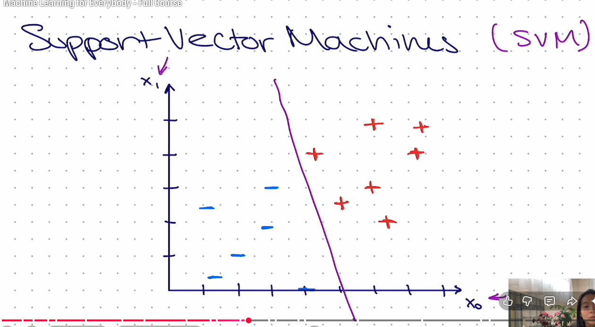

### Simple definition

**Draw the widest possible street between two classes.** Among all the lines that separate the classes, an SVM picks the one that stays **as far as possible from the nearest points of both sides**.

### What problem it solves

Many lines can separate the training data, and most of them pass uncomfortably close to some points. A new point slightly off from the training data could then land on the wrong side. **The widest street gives the most room for error**, so it usually generalises best.

With the **kernel trick** (below), SVMs also handle data that **no straight line can separate**.

### How it works

1. Find the line (or plane) that separates the classes **with the biggest gap (margin)**.
2. The points that sit **right on the edge of the street** are the **support vectors**. They alone decide where the line goes.
3. A new point is classified by **which side of the line** it falls on.
4. If the data overlaps, allow a few points inside the street or on the wrong side, but **charge a penalty** for each one.

### The math

The line is $\mathbf{w} \cdot \mathbf{x} + b = 0$. The street's edges are where this equals $+1$ and $-1$.

$$
\text{street width (margin)} = \frac{2}{\lVert \mathbf{w} \rVert}
$$

So **a wider street means smaller weights.** The SVM's goal:

> **Make $\lVert\mathbf{w}\rVert$ as small as possible (wide street), while keeping every point on its correct side of the street.**

**Why the margin is $2/\lVert\mathbf{w}\rVert$.** The distance from any point $\mathbf{x}_0$ to the line $\mathbf{w}\cdot\mathbf{x} + b = 0$ is

$$
\text{distance} = \frac{\lvert \mathbf{w}\cdot\mathbf{x}_0 + b \rvert}{\lVert\mathbf{w}\rVert}
$$

Points on the street's edges have $\lvert\mathbf{w}\cdot\mathbf{x}_0 + b\rvert = 1$, so each edge is $1/\lVert\mathbf{w}\rVert$ from the centre line, and the full street is $2/\lVert\mathbf{w}\rVert$ wide.

**As an optimisation problem** (labels $y_i \in \{-1, +1\}$):

$$
\min_{\mathbf{w},\,b}\ \frac{1}{2}\lVert\mathbf{w}\rVert^2 \quad\text{subject to}\quad y_i(\mathbf{w}\cdot\mathbf{x}_i + b) \ge 1 \ \text{ for every } i
$$

The constraint $y_i(\mathbf{w}\cdot\mathbf{x}_i + b) \ge 1$ packs "correct side and outside the street" into one inequality for both classes. Minimising $\frac{1}{2}\lVert\mathbf{w}\rVert^2$ gives the same answer as maximising $2/\lVert\mathbf{w}\rVert$, and it is a convex problem with a single best solution.

**Prediction** is simply which side of the line the point falls on:

$$
\hat{y} = \text{sign}(\mathbf{w}\cdot\mathbf{x} + b)
$$

### Worked example

| Class −1 | (1, 1), (3, 0), (0, 3), (2, 2) |
|---|---|
| **Class +1** | **(4, 4), (5, 5), (6, 3), (3, 6)** |

The closest points from opposite classes are **(2, 2)** and **(4, 4)**, so they become the support vectors and the line goes exactly between them. By symmetry, $\mathbf{w}$ points along the direction from (2, 2) to (4, 4), so $\mathbf{w} = (a, a)$. Both support vectors must sit exactly on the street's edges:

$$
(4,4):\ 4a + 4a + b = +1 \qquad (2,2):\ 2a + 2a + b = -1
$$

Subtracting gives $4a = 2$, so $a = 0.5$ and $b = 1 - 8(0.5) = -3$. The solution is $\mathbf{w} = (0.5,\ 0.5)$, $b = -3$, so the boundary is $x_1 + x_2 = 6$.

**Check:**

| Point | $0.5x_1 + 0.5x_2 - 3$ | Meaning |
|---|---:|---|
| (2, 2), class −1 | −1.0 | exactly on the edge → **support vector** |
| (4, 4), class +1 | +1.0 | exactly on the edge → **support vector** |
| (1, 1), class −1 | −2.0 | safely on its side |
| (5, 5), class +1 | +2.0 | safely on its side |

$$
\text{margin} = \frac{2}{\sqrt{0.5^2 + 0.5^2}} = \frac{2}{0.707} = 2.83
$$

That is exactly the distance between (2, 2) and (4, 4).

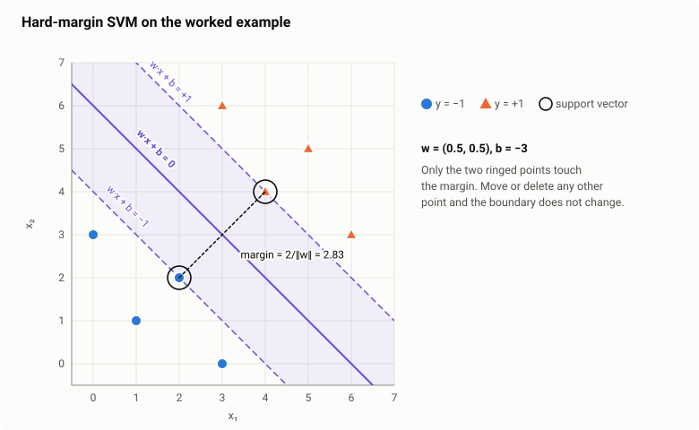

**Key insight:** delete (1, 1) or move (5, 5) further away and **nothing changes**. Only the support vectors matter.

### Soft margin and the C parameter

Real data overlaps, so a perfect street is impossible. The **soft-margin SVM** allows violations but charges for each one with **hinge loss**:

$$
\text{hinge loss} = \max(0,\ 1 - y \cdot f(\mathbf{x}))
$$

In words: **no cost if the point is safely outside the street; the cost grows the further it intrudes.**

The full soft-margin objective balances street width against total penalty:

$$
\min_{\mathbf{w},\,b}\ \underbrace{\frac{1}{2}\lVert\mathbf{w}\rVert^2}_{\text{wide street}} + C\sum_{i=1}^{n}\underbrace{\max\big(0,\ 1 - y_i(\mathbf{w}\cdot\mathbf{x}_i + b)\big)}_{\text{penalty for violations}}
$$

| New point (true class +1) | Score $f(\mathbf{x})$ | Situation | Penalty |
|---|---:|---|---:|
| (5, 5) | 2.0 | correct, outside the street | 0 |
| (3.5, 3.5) | 0.5 | correct, but **inside** the street | 0.5 |
| (2.5, 2.5) | −0.5 | **wrong side** | 1.5 |

**C** decides how much you care about these penalties:

| C | Behaviour | Risk |
|---|---|---|
| **Large** | "Don't tolerate mistakes" → narrow street | overfitting |
| **Small** | "A wide street matters more" → tolerates some errors | underfitting |

**SVM vs logistic regression:** both draw a line and both use a "margin-based" loss. Hinge loss becomes **exactly zero** for safely classified points, which is why only the support vectors matter. Logistic loss is never zero, so every point has some influence and the output is a probability.

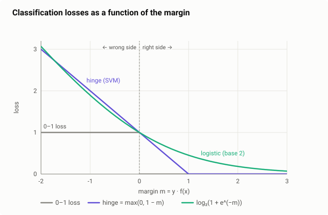

### The kernel trick: separating the "unseparable"

**Problem:** some data can't be split by a straight line. In the figure's left panel, the + points are on both outer ends and the − points are in the middle, so no single cut-off works.

**Idea:** add a new feature. Plot each point at $(x, x^2)$ instead of just $x$, and the outer points rise up high. **Now a flat line separates them.**

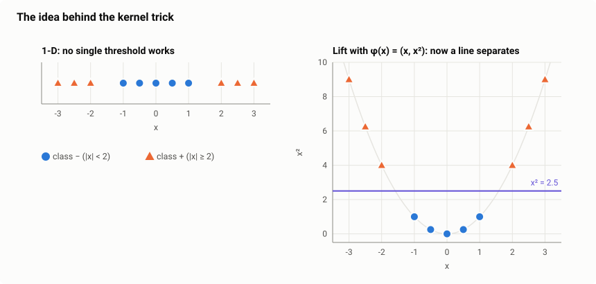

**The "trick":** an SVM only ever needs **similarities between pairs of points**, never the points themselves. A **kernel** is a function that gives the similarity *as if* the points had been lifted to a higher-dimensional space, without actually building that space. You get curvy boundaries at the cost of a linear model.

| Kernel | Plain meaning | When |
|---|---|---|
| **Linear** | no lifting, a plain straight line | many features, e.g. text |
| **Polynomial** | considers feature combinations ($x_1x_2$, $x^2$, …) | interactions matter |
| **RBF (Gaussian)** | "similarity falls off with distance"; can draw almost any shape | **default choice** |

The RBF kernel's formula:

$$
K(\mathbf{x}, \mathbf{z}) = \exp\big(-\gamma\,\lVert\mathbf{x} - \mathbf{z}\rVert^2\big)
$$

Identical points give $K = 1$, and $K$ falls toward 0 as they move apart. Example with $\gamma = 0.5$, $\mathbf{x} = (1, 2)$, $\mathbf{z} = (3, 1)$: $\lVert\mathbf{x}-\mathbf{z}\rVert^2 = 4 + 1 = 5$, so $K = e^{-2.5} = 0.082$, meaning the points are not very similar.

With a kernel, the prediction becomes a weighted vote of the support vectors, each weighted by its similarity to the new point:

$$
f(\mathbf{x}) = \sum_{i \in \text{SV}} \alpha_i\, y_i\, K(\mathbf{x}_i, \mathbf{x}) + b
$$

RBF has a parameter **gamma**: high gamma means each point only influences its immediate area (wiggly boundary, overfitting); low gamma means a smoother boundary. **Tune C and gamma together** with grid search.

### When to use it

| Good for | Bad for |
|---|---|
| Small–medium datasets (up to tens of thousands of samples) | Millions of samples (training gets very slow) |
| Many features, even more features than samples | When you need probabilities (needs extra calibration) |
| Clear-margin problems, text, bioinformatics | When you need to explain the model |

Always **scale features** first.

<b>Deeper math: the optimisation problem, dual form, and kernels</b>

**Soft margin with slack variables.** Each point gets a slack $\xi_i \ge 0$, meaning how far it is allowed to violate the margin:

$$
\min_{\mathbf{w},b,\xi}\ \tfrac{1}{2}\lVert\mathbf{w}\rVert^2 + C\sum_i \xi_i \quad\text{s.t.}\quad y_i(\mathbf{w}^\top\mathbf{x}_i + b) \ge 1 - \xi_i,\ \ \xi_i \ge 0
$$

At the optimum $\xi_i = \max(0,\ 1 - y_i f(\mathbf{x}_i))$, which is exactly the hinge loss.

**Dual form.** With Lagrange multipliers $\alpha_i$:

$$
\max_{\boldsymbol\alpha}\ \sum_i\alpha_i - \tfrac{1}{2}\sum_{i,j}\alpha_i\alpha_j y_i y_j\,\mathbf{x}_i^\top\mathbf{x}_j \quad\text{s.t.}\quad 0 \le \alpha_i \le C,\ \sum_i \alpha_i y_i = 0
$$

$\alpha_i > 0$ only for support vectors, and the data appears only as dot products $\mathbf{x}_i^\top\mathbf{x}_j$. Replacing these with $K(\mathbf{x}_i,\mathbf{x}_j)$ is the kernel trick.

**Kernel check by hand.** For $K(\mathbf{x},\mathbf{z}) = (\mathbf{x}^\top\mathbf{z})^2$ with $\mathbf{x} = (1,2)$, $\mathbf{z} = (3,1)$: kernel $= 5^2 = 25$. The explicit map $\phi(\mathbf{x}) = (x_1^2, \sqrt{2}x_1x_2, x_2^2)$ gives $(1, 2\sqrt2, 4)\cdot(9, 3\sqrt2, 1) = 9 + 12 + 4 = 25$, the same value.

**Cost:** training is about $O(n^2)$ to $O(n^3)$. For big data use `LinearSVC` or `SGDClassifier(loss="hinge")`.

---

## 6. Which model should I use?

| | **KNN** | **Naive Bayes** | **Logistic Regression** | **SVM (RBF)** |
|---|---|---|---|---|
| **Core idea** | vote of similar examples | count-based probabilities | weighted score → probability | widest street |
| **Boundary shape** | any shape | simple | straight line | any shape (with kernel) |
| **Training speed** | instant | very fast | fast | slow for large data |
| **Prediction speed** | slow (compares with all data) | very fast | very fast | medium |
| **Needs feature scaling** | **yes** | no | yes | **yes** |
| **Gives probabilities** | rough | yes, but overconfident | **yes, reliable** | not by default |
| **Easy to explain** | "these neighbours" | per-word evidence | **weights = odds** | hard |
| **Best at** | similarity search | text, little data | baselines, explainable models | small/medium complex data |

**A practical playbook:**

1. Start with a **dumb baseline** (always predict the majority class) so you know what "useless" looks like.
2. Train **logistic regression** next. It is often good enough.
3. Text with little data → try **Naive Bayes** or a linear SVM.
4. Non-linear patterns on small/medium data → try an **RBF SVM**. (For tabular data, also try gradient-boosted trees, usually the strongest option there.)
5. Similarity or embedding search → **KNN** (approximate nearest neighbours at scale).
