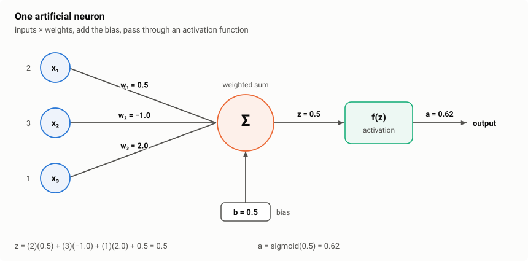
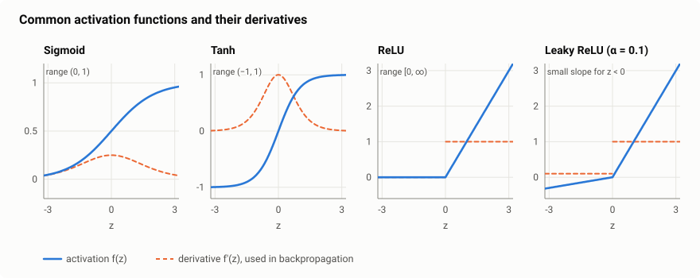
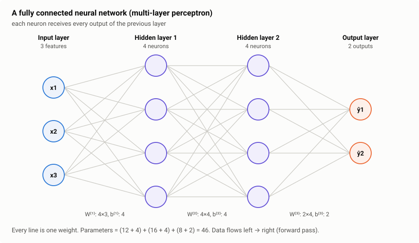
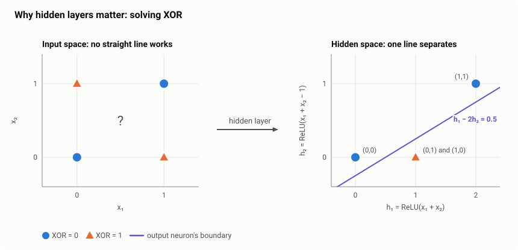
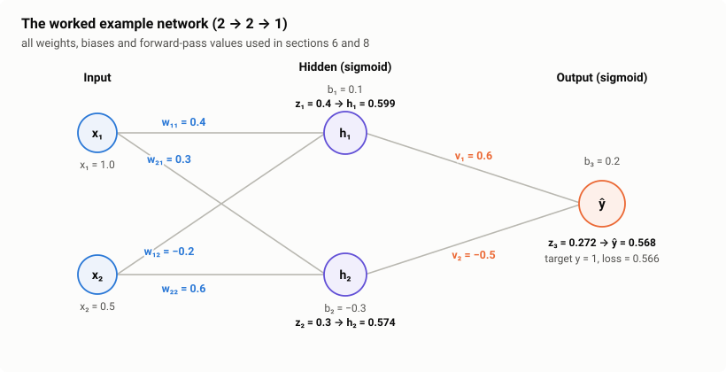
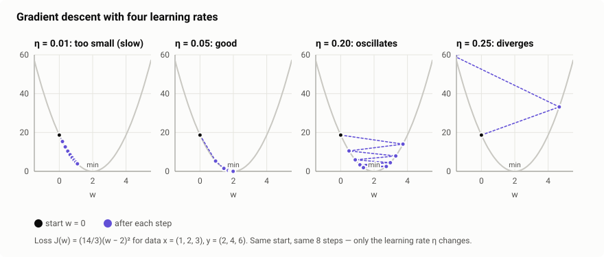
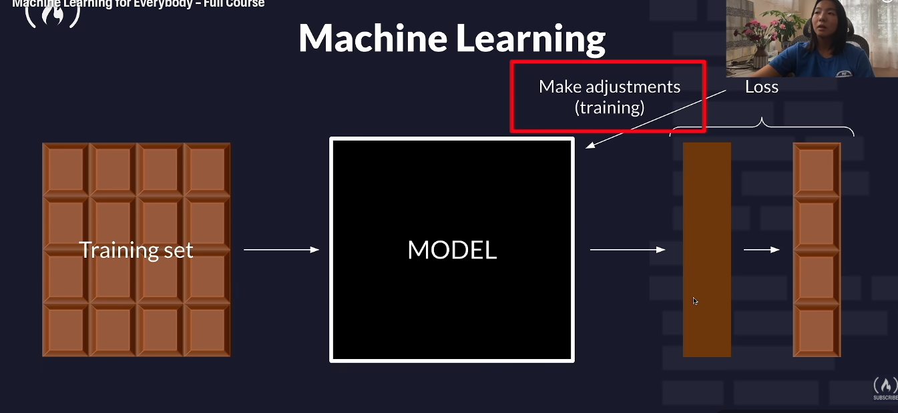
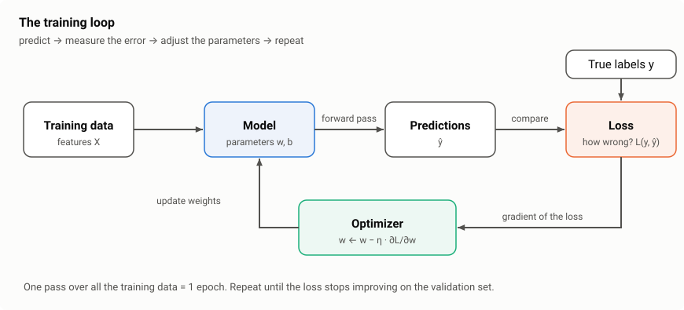

# Neural Networks: Fundamentals

> **What this note covers:** the building blocks of a neural network and the math that makes it learn.
>
> **Neuron → Weights and bias → Activation functions → Layers → Forward propagation → Derivatives → Backpropagation → Gradient descent → The training loop**
>
> One small network (2 inputs → 2 hidden neurons → 1 output) is worked through by hand from start to finish. Every number was computed and checked. Figures live in [`images2/`](./images2/).

## Contents

1. [What is a neural network?](#1-what-is-a-neural-network)
2. [The neuron: weights, bias and weighted sum](#2-the-neuron-weights-bias-and-weighted-sum)
3. [Activation functions](#3-activation-functions)
4. [Layers: input, hidden, output](#4-layers-input-hidden-output)
5. [Why hidden layers matter: the XOR problem](#5-why-hidden-layers-matter-the-xor-problem)
6. [Forward propagation: a full worked example](#6-forward-propagation-a-full-worked-example)
7. [Derivatives: the math you need for learning](#7-derivatives-the-math-you-need-for-learning)
8. [Backpropagation: computing every gradient](#8-backpropagation-computing-every-gradient)
9. [Gradient descent: updating the weights](#9-gradient-descent-updating-the-weights)
10. [The training loop](#10-the-training-loop)
11. [Practical essentials](#11-practical-essentials)

---

## 1. What is a neural network?

### Simple definition

A **neural network** is a model made of many small computing units called **neurons**, arranged in **layers**. Each neuron does something very simple: it multiplies its inputs by weights, adds them up, adds a bias, and passes the result through an activation function. Stacking many neurons in layers lets the network learn very complex patterns.

### What problem it solves

Classic models like linear or logistic regression can only draw **straight-line boundaries**, and they need humans to design good features. Neural networks:

- learn **non-linear** patterns (curves, spirals, anything)
- learn **their own features** from raw data (pixels, audio, text), with no hand-crafted features needed
- scale up: more data and bigger networks usually give better results

This is why neural networks power image recognition, speech recognition, translation and large language models.

### How it works, in one paragraph

Data enters the **input layer**. Each **hidden layer** transforms it into a new, more useful representation. The **output layer** produces the prediction. A **loss function** measures how wrong the prediction is. **Backpropagation** computes how much each weight contributed to the error, and **gradient descent** adjusts every weight slightly to reduce it. Repeat thousands of times.

> **Connection to the previous note:** a single neuron with a sigmoid activation is *exactly* logistic regression. A neural network is many logistic-regression-like units stacked together.

---

## 2. The neuron: weights, bias and weighted sum

### Simple definition

A **neuron** takes several numbers in, combines them into one number, and decides how strongly to "fire".

### The parts

| Part | Symbol | What it does |
|---|---|---|
| **Inputs** | $x_1, x_2, \dots, x_n$ | the features, or the outputs of the previous layer |
| **Weights** | $w_1, w_2, \dots, w_n$ | how important each input is, and in which direction |
| **Bias** | $b$ | shifts the result up or down, independent of the inputs |
| **Weighted sum** | $z$ | inputs × weights, added up, plus the bias |
| **Activation function** | $f$ | turns $z$ into the neuron's output, adding non-linearity |
| **Output (activation)** | $a$ | the value passed on to the next layer |

### The math

**Step 1 — weighted sum:**

$$
z = w_1x_1 + w_2x_2 + \dots + w_nx_n + b = \sum_{i=1}^{n} w_i x_i + b = \mathbf{w}\cdot\mathbf{x} + b
$$

**Step 2 — activation:**

$$
a = f(z)
$$

### Worked example

Inputs $\mathbf{x} = (2,\ 3,\ 1)$, weights $\mathbf{w} = (0.5,\ -1.0,\ 2.0)$, bias $b = 0.5$, sigmoid activation.

$$
z = (2)(0.5) + (3)(-1.0) + (1)(2.0) + 0.5 = 1 - 3 + 2 + 0.5 = 0.5
$$

$$
a = \sigma(0.5) = \frac{1}{1 + e^{-0.5}} = 0.622
$$

The same $z = 0.5$ through other activations gives: ReLU $= 0.5$, tanh $= 0.462$.

### What the weights mean

| Weight | Effect on the neuron |
|---|---|
| Large positive | this input strongly **pushes the neuron on** |
| Large negative | this input strongly **pushes the neuron off** |
| Near zero | this input is **ignored** |

In the example, $x_2 = 3$ has weight $-1.0$, so it pulls $z$ down by 3. Learning means finding weights that make these pushes and pulls produce correct answers.

### What the bias does

The bias sets **how easily the neuron fires**, whatever the inputs are. Keep the same inputs and weights and change only $b$:

| Bias $b$ | $z$ | $a = \sigma(z)$ | Neuron is… |
|---:|---:|---:|---|
| −3.0 | −3.0 | 0.047 | almost off |
| 0.5 | 0.5 | 0.622 | moderately on |
| 3.0 | 3.0 | 0.953 | almost fully on |

**Geometric view:** $\mathbf{w}\cdot\mathbf{x} + b = 0$ is a line (or plane). The **weights set its direction** and the **bias shifts it** away from the origin. Without a bias, every boundary would be forced through the origin, which is a big restriction.

---

## 3. Activation functions

### Simple definition

An **activation function** takes the weighted sum $z$ and transforms it, usually non-linearly. It decides the neuron's output.

### Why we need them: without activation, depth is useless

Suppose two layers have no activation (just weighted sums):

$$
h = 2x + 1 \qquad y = 3h - 4
$$

Substitute $h$:

$$
y = 3(2x + 1) - 4 = 6x - 1
$$

Two layers collapsed into **one straight line**. The same holds in general: $W_2(W_1\mathbf{x} + \mathbf{b}_1) + \mathbf{b}_2 = W'\mathbf{x} + \mathbf{b}'$. **Stacking linear layers is still linear**, however many you add. The activation function's non-linearity is what lets a network bend and model complex shapes.

### The main activation functions

| Function | Formula $f(z)$ | Derivative $f'(z)$ | Output range | Typical use |
|---|---|---|---|---|
| **Sigmoid** | $\frac{1}{1+e^{-z}}$ | $f(z)\,(1 - f(z))$ | (0, 1) | output layer for **binary** classification |
| **Tanh** | $\frac{e^{z} - e^{-z}}{e^{z} + e^{-z}}$ | $1 - f(z)^2$ | (−1, 1) | hidden layers in older nets, RNNs |
| **ReLU** | $\max(0, z)$ | 1 if $z > 0$, else 0 | [0, ∞) | **default for hidden layers** |
| **Leaky ReLU** | $z$ if $z > 0$, else $\alpha z$ | 1 if $z > 0$, else $\alpha$ | (−∞, ∞) | hidden layers, avoids "dead" neurons |
| **Softmax** | $\frac{e^{z_k}}{\sum_j e^{z_j}}$ | — | (0, 1), sums to 1 | output layer for **multiclass** classification |
| **Linear** (none) | $z$ | 1 | (−∞, ∞) | output layer for **regression** |

### Values at a few points

| $z$ | −2 | −1 | 0 | 1 | 2 |
|---|---:|---:|---:|---:|---:|
| sigmoid $\sigma(z)$ | 0.119 | 0.269 | 0.500 | 0.731 | 0.881 |
| sigmoid derivative $\sigma'(z)$ | 0.105 | 0.197 | **0.250** | 0.197 | 0.105 |
| tanh | −0.964 | −0.762 | 0.000 | 0.762 | 0.964 |
| tanh derivative | 0.071 | 0.420 | **1.000** | 0.420 | 0.071 |
| ReLU | 0 | 0 | 0 | 1 | 2 |
| ReLU derivative | 0 | 0 | 0 | 1 | 1 |

### Softmax: turning scores into probabilities

For multiclass output, softmax converts the raw scores (**logits**) into probabilities that add up to 1. Example with scores $\mathbf{z} = (2.0,\ 1.0,\ 0.1)$:

$$
e^{2.0} = 7.389 \qquad e^{1.0} = 2.718 \qquad e^{0.1} = 1.105 \qquad \text{sum} = 11.213
$$

$$
\text{softmax}(\mathbf{z}) = \left(\frac{7.389}{11.213},\ \frac{2.718}{11.213},\ \frac{1.105}{11.213}\right) = (0.659,\ 0.242,\ 0.099)
$$

The largest score gets the largest probability, but every class keeps some probability.

### Why ReLU replaced sigmoid in hidden layers: vanishing gradients

During learning, gradients are **multiplied by the activation's derivative at every layer** (section 8). The sigmoid's derivative is **at most 0.25**. Through 10 sigmoid layers, in the best case:

$$
0.25^{10} \approx 0.00000095
$$

The learning signal almost **vanishes** before it reaches the early layers, so they barely learn. ReLU's derivative is exactly **1** for positive inputs, so the signal passes through without shrinking. This is the main reason deep networks became trainable.

**ReLU's weakness — "dead" neurons:** if a neuron's $z$ is always negative, its output and derivative are always 0, so it never updates again. Leaky ReLU fixes this with a small slope (e.g. $\alpha = 0.01$) for negative inputs.

### Which activation to use?

| Where | Use |
|---|---|
| Hidden layers | **ReLU** (default); Leaky ReLU or GELU as alternatives |
| Output, regression | **Linear** (no activation) |
| Output, binary classification | **Sigmoid** |
| Output, multiclass (one label) | **Softmax** |
| Output, multi-label (several labels can be true) | **Sigmoid** on each output |

---

## 4. Layers: input, hidden, output

### Simple definition

Neurons are organised into **layers**. Each layer takes the previous layer's outputs as its inputs.

| Layer | What it is | Number of neurons |
|---|---|---|
| **Input layer** | just holds the raw features; **does no computation** | = number of features (e.g. 784 for a 28×28 image) |
| **Hidden layers** | transform the data into more useful representations | you choose (a hyperparameter) |
| **Output layer** | produces the final prediction | = number of outputs (1 for regression or binary, $K$ for $K$ classes) |

In a **fully connected** (dense) layer, every neuron receives every output of the previous layer. A network made of such layers is called a **multi-layer perceptron (MLP)**.

**What hidden layers learn:** each layer builds on the previous one. In an image network, early layers detect **edges**, middle layers combine edges into **shapes** (eyes, wheels), and later layers combine shapes into **objects** (faces, cars). Nobody programs these features; the network discovers them during training.

### The math: one layer in matrix form

Computing neurons one by one is slow. A whole layer is computed at once with a matrix:

$$
\mathbf{z}^{(l)} = W^{(l)}\,\mathbf{a}^{(l-1)} + \mathbf{b}^{(l)} \qquad \mathbf{a}^{(l)} = f\big(\mathbf{z}^{(l)}\big)
$$

| Symbol | Shape | Meaning |
|---|---|---|
| $\mathbf{a}^{(l-1)}$ | $n_{l-1} \times 1$ | outputs of the previous layer ($\mathbf{a}^{(0)} = \mathbf{x}$) |
| $W^{(l)}$ | $n_l \times n_{l-1}$ | weights: **row** $j$ = all incoming weights of neuron $j$ |
| $\mathbf{b}^{(l)}$ | $n_l \times 1$ | one bias per neuron |
| $f$ | — | activation, applied to each element |

This is why GPUs matter: neural networks are mostly large matrix multiplications.

### Counting parameters

A dense layer from $n_{\text{in}}$ to $n_{\text{out}}$ neurons has:

$$
\text{parameters} = \underbrace{n_{\text{in}} \times n_{\text{out}}}_{\text{weights}} + \underbrace{n_{\text{out}}}_{\text{biases}}
$$

**The network in the figure (3 → 4 → 4 → 2):**

$$
(3 \times 4 + 4) + (4 \times 4 + 4) + (4 \times 2 + 2) = 16 + 20 + 10 = 46
$$

**A digit classifier (784 → 128 → 64 → 10):**

| Layer | Weights | Biases | Total |
|---|---:|---:|---:|
| 784 → 128 | 100,352 | 128 | 100,480 |
| 128 → 64 | 8,192 | 64 | 8,256 |
| 64 → 10 | 640 | 10 | 650 |
| **All** | | | **109,386** |

Notice that most parameters sit in the first layer, because the input is large.

### Depth vs width

- **Width** = neurons per layer. **Depth** = number of hidden layers.
- The **universal approximation theorem** says that one hidden layer with enough neurons can approximate any continuous function. In practice, **deeper** networks learn the same function with far fewer parameters, because each layer reuses features built by the layer before.
- "**Deep** learning" just means networks with many hidden layers.

---

## 5. Why hidden layers matter: the XOR problem

### The problem

XOR ("exclusive or") outputs 1 when exactly one input is 1:

| $x_1$ | $x_2$ | XOR |
|---:|---:|---:|
| 0 | 0 | 0 |
| 0 | 1 | 1 |
| 1 | 0 | 1 |
| 1 | 1 | 0 |

Plot the points (left panel below): the 1s are on one diagonal and the 0s on the other. **No single straight line separates them**, so a single neuron (or logistic regression) **cannot** solve XOR.

### The solution: one hidden layer with two ReLU neurons

$$
h_1 = \text{ReLU}(x_1 + x_2) \qquad h_2 = \text{ReLU}(x_1 + x_2 - 1) \qquad \hat{y} = h_1 - 2h_2
$$

| $x_1$ | $x_2$ | $h_1$ | $h_2$ | $\hat{y} = h_1 - 2h_2$ | XOR |
|---:|---:|---:|---:|---:|---:|
| 0 | 0 | 0 | 0 | 0 | 0 |
| 0 | 1 | 1 | 0 | **1** | 1 |
| 1 | 0 | 1 | 0 | **1** | 1 |
| 1 | 1 | 2 | 1 | 2 − 2 = **0** | 0 |

All four are correct.

**What happened:** the hidden layer **moved the points into a new space** $(h_1, h_2)$ where they *are* separable by a straight line. That is the whole job of a hidden layer: transform the data until the problem becomes easy for the next layer. Here we chose the weights by hand. In practice, backpropagation finds them.

---

## 6. Forward propagation: a full worked example

### Simple definition

**Forward propagation** (the forward pass) means pushing the input through the network, layer by layer, to get a prediction.

### The network

2 inputs → 2 hidden neurons (sigmoid) → 1 output neuron (sigmoid), for binary classification.

| Parameter | Value | Parameter | Value |
|---|---:|---|---:|
| $w_{11}$ ($x_1 \to h_1$) | 0.4 | $w_{21}$ ($x_1 \to h_2$) | 0.3 |
| $w_{12}$ ($x_2 \to h_1$) | −0.2 | $w_{22}$ ($x_2 \to h_2$) | 0.6 |
| $b_1$ | 0.1 | $b_2$ | −0.3 |
| $v_1$ ($h_1 \to \hat{y}$) | 0.6 | $v_2$ ($h_2 \to \hat{y}$) | −0.5 |
| $b_3$ | 0.2 | | |

**Input:** $x_1 = 1.0$, $x_2 = 0.5$. **True label:** $y = 1$.

### Step 1 — hidden layer

$$
z_1 = w_{11}x_1 + w_{12}x_2 + b_1 = (0.4)(1.0) + (-0.2)(0.5) + 0.1 = 0.4
\qquad h_1 = \sigma(0.4) = 0.5987
$$

$$
z_2 = w_{21}x_1 + w_{22}x_2 + b_2 = (0.3)(1.0) + (0.6)(0.5) - 0.3 = 0.3
\qquad h_2 = \sigma(0.3) = 0.5744
$$

In matrix form, this is one operation:

$$
\begin{bmatrix} z_1 \\ z_2 \end{bmatrix}
=
\begin{bmatrix} 0.4 & -0.2 \\ 0.3 & 0.6 \end{bmatrix}
\begin{bmatrix} 1.0 \\ 0.5 \end{bmatrix}
+
\begin{bmatrix} 0.1 \\ -0.3 \end{bmatrix}
=
\begin{bmatrix} 0.4 \\ 0.3 \end{bmatrix}
$$

### Step 2 — output layer

$$
z_3 = v_1h_1 + v_2h_2 + b_3 = (0.6)(0.5987) + (-0.5)(0.5744) + 0.2 = 0.3592 - 0.2872 + 0.2 = 0.2720
$$

$$
\hat{y} = \sigma(0.2720) = 0.5676
$$

The network says "56.8% chance of class 1". The true answer is class 1, so it's unsure and leaning slightly the right way.

### Step 3 — loss

Binary cross-entropy for $y = 1$:

$$
L = -\big[y\log\hat{y} + (1-y)\log(1-\hat{y})\big] = -\log(0.5676) = 0.5664
$$

The goal of training is to push $\hat{y}$ toward 1 and $L$ toward 0. To do that we need to know **which way to move each of the 9 parameters**. That takes derivatives.

---

## 7. Derivatives: the math you need for learning

### Simple definition

A **derivative** measures **how much the output changes when you nudge the input a tiny bit**. It is the slope of the function at a point.

$$
f'(x) = \frac{df}{dx} = \lim_{h \to 0}\frac{f(x+h) - f(x)}{h}
$$

**Why it matters for learning:** if $\frac{\partial L}{\partial w}$ is the derivative of the loss with respect to a weight:

- **positive** → increasing $w$ increases the loss, so **decrease $w$**
- **negative** → increasing $w$ decreases the loss, so **increase $w$**
- its **size** tells you how sensitive the loss is to that weight

### Rules you need

| Rule | Function | Derivative | Example |
|---|---|---|---|
| Constant | $c$ | $0$ | $\frac{d}{dx}5 = 0$ |
| Power | $x^n$ | $nx^{n-1}$ | $\frac{d}{dx}x^3 = 3x^2$ |
| Constant multiple | $c\,g(x)$ | $c\,g'(x)$ | $\frac{d}{dx}4x^2 = 8x$ |
| Sum | $g(x) + h(x)$ | $g'(x) + h'(x)$ | $\frac{d}{dx}(x^2 + 3x) = 2x + 3$ |
| Exponential | $e^x$ | $e^x$ | |
| Log | $\ln x$ | $\frac{1}{x}$ | $\frac{d}{dp}\big(-\ln p\big) = -\frac{1}{p}$ |
| **Chain rule** | $g(h(x))$ | $g'(h(x)) \cdot h'(x)$ | see below |

### The chain rule: the heart of backpropagation

When functions are **nested**, multiply the derivatives of each step:

$$
\frac{dy}{dx} = \frac{dy}{du}\cdot\frac{du}{dx}
$$

**Example:** $f(w) = (3w + 1)^2$ at $w = 1$. Let $u = 3w + 1$, so $f = u^2$.

$$
\frac{df}{du} = 2u \qquad \frac{du}{dw} = 3 \qquad \frac{df}{dw} = 2u \cdot 3 = 6(3w + 1)
$$

At $w = 1$: $\frac{df}{dw} = 6 \times 4 = 24$. Nudging $w$ from 1.000 to 1.001 changes $f$ by about $24 \times 0.001 = 0.024$.

A neural network is just a long chain of nested functions (weighted sum → activation → weighted sum → activation → loss), so the chain rule tells us how the loss depends on every weight.

### Partial derivatives: functions of many variables

A loss depends on many weights at once. A **partial derivative** $\frac{\partial L}{\partial w}$ asks how $L$ changes with $w$ **while holding everything else fixed**.

**Example:** one sample with $x = 2$, $y = 7$, model $\hat{y} = wx + b$, loss $L = (wx + b - y)^2 = (2w + b - 7)^2$. At $w = 1$, $b = 1$: $L = (2 + 1 - 7)^2 = 16$.

$$
\frac{\partial L}{\partial w} = 2(2w + b - 7)\cdot 2 = 2(-4)(2) = -16
$$

$$
\frac{\partial L}{\partial b} = 2(2w + b - 7)\cdot 1 = 2(-4) = -8
$$

Both are negative, so increasing $w$ and $b$ will lower the loss, which makes sense since the prediction (3) is below the target (7). The loss is twice as sensitive to $w$ because $w$ is multiplied by $x = 2$.

The **gradient** collects all the partial derivatives into one vector:

$$
\nabla L = \left(\frac{\partial L}{\partial w},\ \frac{\partial L}{\partial b}\right) = (-16,\ -8)
$$

### Derivatives of the activation functions

**Sigmoid.** Using the chain rule on $\sigma(z) = (1 + e^{-z})^{-1}$:

$$
\sigma'(z) = \frac{e^{-z}}{(1+e^{-z})^2} = \sigma(z)\,\big(1 - \sigma(z)\big)
$$

This is very convenient: once you know the output $\sigma(z)$ from the forward pass, the derivative is one multiplication. For example, $\sigma(0.4) = 0.5987$, so $\sigma'(0.4) = 0.5987 \times 0.4013 = 0.2403$.

**Tanh:** $\tanh'(z) = 1 - \tanh^2(z)$. **ReLU:** derivative 1 for $z > 0$ and 0 for $z < 0$.

---

## 8. Backpropagation: computing every gradient

### Simple definition

**Backpropagation** applies the chain rule **backwards** through the network, from the loss to the first layer, to compute how much each weight contributed to the error.

### Why backwards?

Every weight affects the loss only *through* the layers after it. So we start at the loss, compute the error signal at the output, and **reuse** it to get the gradients of the layer before, and so on. Each layer's result is computed once and shared, so the cost of all gradients is about the same as one forward pass. Without this reuse, training large networks would be impossible.

### The chain for one weight

For the weight $w_{11}$ (from $x_1$ to $h_1$), the path to the loss is $w_{11} \to z_1 \to h_1 \to z_3 \to \hat{y} \to L$:

$$
\frac{\partial L}{\partial w_{11}} = \frac{\partial L}{\partial \hat{y}}\cdot\frac{\partial \hat{y}}{\partial z_3}\cdot\frac{\partial z_3}{\partial h_1}\cdot\frac{\partial h_1}{\partial z_1}\cdot\frac{\partial z_1}{\partial w_{11}}
$$

Each factor is a simple local derivative. Now compute them for the worked example.

### Step 1 — the output error

For sigmoid + binary cross-entropy, two of the factors combine into something very simple:

$$
\frac{\partial L}{\partial \hat{y}} = -\frac{y}{\hat{y}} + \frac{1-y}{1-\hat{y}} \qquad \frac{\partial \hat{y}}{\partial z_3} = \hat{y}(1-\hat{y})
$$

$$
\delta_3 = \frac{\partial L}{\partial z_3} = \left(-\frac{y}{\hat{y}} + \frac{1-y}{1-\hat{y}}\right)\hat{y}(1-\hat{y}) = \hat{y} - y
$$

$$
\delta_3 = 0.5676 - 1 = -0.4324
$$

**Prediction minus target.** Negative means "the output is too low, push $z_3$ up".

### Step 2 — output-layer gradients

Since $z_3 = v_1h_1 + v_2h_2 + b_3$, we have $\frac{\partial z_3}{\partial v_1} = h_1$, $\frac{\partial z_3}{\partial v_2} = h_2$ and $\frac{\partial z_3}{\partial b_3} = 1$:

| Parameter | Formula | Value |
|---|---|---:|
| $v_1$ | $\delta_3 \cdot h_1 = (-0.4324)(0.5987)$ | −0.2589 |
| $v_2$ | $\delta_3 \cdot h_2 = (-0.4324)(0.5744)$ | −0.2484 |
| $b_3$ | $\delta_3 \cdot 1$ | −0.4324 |

**Rule:** gradient of a weight = (error at the neuron it feeds into) × (input coming through that weight).

### Step 3 — send the error back to the hidden layer

How much does each hidden output affect the loss? Through $z_3$, $\frac{\partial z_3}{\partial h_1} = v_1$:

$$
\frac{\partial L}{\partial h_1} = \delta_3 \cdot v_1 = (-0.4324)(0.6) = -0.2595
\qquad
\frac{\partial L}{\partial h_2} = \delta_3 \cdot v_2 = (-0.4324)(-0.5) = +0.2162
$$

Then pass through each hidden neuron's sigmoid, using $\sigma'(z) = h(1-h)$:

$$
\delta_1 = \frac{\partial L}{\partial h_1}\cdot h_1(1-h_1) = (-0.2595)(0.5987 \times 0.4013) = (-0.2595)(0.2403) = -0.0623
$$

$$
\delta_2 = \frac{\partial L}{\partial h_2}\cdot h_2(1-h_2) = (0.2162)(0.5744 \times 0.4256) = (0.2162)(0.2445) = +0.0529
$$

**What the signs mean:** $h_1$ helps the output ($v_1 > 0$), so the network wants **more** $h_1$ ($\delta_1 < 0$). $h_2$ hurts the output ($v_2 < 0$), so it wants **less** $h_2$ ($\delta_2 > 0$).

### Step 4 — hidden-layer gradients

Same rule as before: error at the neuron × the input through the weight.

| Parameter | Formula | Value |
|---|---|---:|
| $w_{11}$ | $\delta_1 \cdot x_1 = (-0.0623)(1.0)$ | −0.0623 |
| $w_{12}$ | $\delta_1 \cdot x_2 = (-0.0623)(0.5)$ | −0.0312 |
| $b_1$ | $\delta_1$ | −0.0623 |
| $w_{21}$ | $\delta_2 \cdot x_1 = (0.0529)(1.0)$ | +0.0529 |
| $w_{22}$ | $\delta_2 \cdot x_2 = (0.0529)(0.5)$ | +0.0264 |
| $b_2$ | $\delta_2$ | +0.0529 |

Notice the hidden-layer gradients are about **4–8× smaller** than the output-layer ones. Part of that is the sigmoid derivative (0.24): this is the vanishing-gradient effect from section 3, on a small scale.

### Checking the gradients numerically

You can verify any gradient by nudging the weight a tiny amount $\varepsilon$ and measuring the change in loss:

$$
\frac{\partial L}{\partial w} \approx \frac{L(w + \varepsilon) - L(w - \varepsilon)}{2\varepsilon}
$$

With $\varepsilon = 10^{-6}$, all nine numerical gradients match the backpropagation values above to 5 decimal places. This **gradient check** is the standard way to test a hand-written backprop implementation.

### The general formulas (any network, any depth)

For layer $l$ with weights $W^{(l)}$, using $\odot$ for element-wise multiplication:

$$
\boldsymbol{\delta}^{(L)} = \hat{\mathbf{y}} - \mathbf{y} \qquad \text{(output layer, sigmoid/softmax + cross-entropy)}
$$

$$
\boldsymbol{\delta}^{(l)} = \Big(W^{(l+1)\top}\,\boldsymbol{\delta}^{(l+1)}\Big) \odot f'\big(\mathbf{z}^{(l)}\big) \qquad \text{(send the error back one layer)}
$$

$$
\frac{\partial L}{\partial W^{(l)}} = \boldsymbol{\delta}^{(l)}\,\mathbf{a}^{(l-1)\top} \qquad \frac{\partial L}{\partial \mathbf{b}^{(l)}} = \boldsymbol{\delta}^{(l)}
$$

These are exactly steps 1–4 above, written for whole layers at once. Frameworks like PyTorch and TensorFlow do this automatically (**autograd**), but this is what they compute.

---

## 9. Gradient descent: updating the weights

### Simple definition

Once we have the gradients, move every parameter a small step **against** its gradient, the direction that lowers the loss.

$$
w \leftarrow w - \eta\,\frac{\partial L}{\partial w}
$$

$\eta$ (eta) is the **learning rate**: how big each step is.

### One update on the worked example ($\eta = 0.5$)

| Parameter | Old value | Gradient | New value = old − 0.5 × gradient |
|---|---:|---:|---:|
| $w_{11}$ | 0.4000 | −0.0623 | 0.4312 |
| $w_{12}$ | −0.2000 | −0.0312 | −0.1844 |
| $b_1$ | 0.1000 | −0.0623 | 0.1312 |
| $w_{21}$ | 0.3000 | +0.0529 | 0.2736 |
| $w_{22}$ | 0.6000 | +0.0264 | 0.5868 |
| $b_2$ | −0.3000 | +0.0529 | −0.3264 |
| $v_1$ | 0.6000 | −0.2589 | 0.7294 |
| $v_2$ | −0.5000 | −0.2484 | −0.3758 |
| $b_3$ | 0.2000 | −0.4324 | 0.4162 |

**Run the forward pass again** with the new weights: $\hat{y}$ goes from **0.568 → 0.658** and the loss from **0.566 → 0.418**. One step, 26% less loss.

**Keep repeating** (same sample, same learning rate):

| Update steps | $\hat{y}$ | Loss |
|---:|---:|---:|
| 0 | 0.568 | 0.566 |
| 1 | 0.658 | 0.418 |
| 2 | 0.723 | 0.324 |
| 5 | 0.832 | 0.184 |
| 10 | 0.903 | 0.102 |
| 20 | 0.950 | 0.051 |
| 50 | 0.981 | 0.020 |

That is learning: forward pass, loss, backpropagation, update, repeated. (A real network trains on many samples, not one, but each step works exactly like this.)

### Choosing the learning rate

The figure shows a one-weight model learning $y = 2x$ from the points $(1,2), (2,4), (3,6)$ with four learning rates. The loss is $J(w) = \frac{14}{3}(w-2)^2$, with its minimum at $w = 2$.

| Learning rate | What happens |
|---|---|
| Too small (0.01) | moves the right way, but painfully slowly |
| Good (0.05) | reaches the minimum quickly |
| Too large (0.20) | overshoots and bounces from side to side |
| Far too large (0.25) | every step lands further away: the loss **explodes** |

If the loss suddenly becomes huge or NaN during training, the learning rate is the first thing to lower.

---

## 10. The training loop

The lecture slide sums it up: the **training set** goes into the **model**, the output is compared with the truth to compute the **loss**, and the loss is used to **make adjustments (training)**.

### The full algorithm

1. **Initialise** all weights to small random numbers and biases to 0.
2. For each **epoch** (one full pass over the training data):
   1. Shuffle the data and split it into **mini-batches** (e.g. 32 samples).
   2. For each mini-batch:
      - **Forward pass:** compute predictions.
      - **Loss:** average the loss over the batch.
      - **Backward pass:** backpropagation gives every gradient.
      - **Update:** $w \leftarrow w - \eta \cdot$ gradient, for every parameter.
   3. Check the loss on the **validation set**.
3. **Stop** when the validation loss stops improving.

### Epoch, batch, iteration

| Term | Meaning |
|---|---|
| **Batch size** | samples used for one update |
| **Iteration** | one update (one batch) |
| **Epoch** | one pass through the whole training set |

Example: 10,000 training images, batch size 100:

$$
\frac{10{,}000}{100} = 100 \text{ iterations per epoch} \qquad 20 \text{ epochs} \Rightarrow 2{,}000 \text{ updates}
$$

### Three ways to batch

| Variant | Samples per update | Trade-off |
|---|---|---|
| Batch gradient descent | all of them | exact gradient but slow, and memory-heavy |
| Stochastic gradient descent (SGD) | 1 | fast but very noisy |
| **Mini-batch** | 32–512 | **standard choice**: fast, fairly stable, uses GPUs well |

### Optimizers: smarter update rules

| Optimizer | Idea |
|---|---|
| **SGD** | the plain rule $w \leftarrow w - \eta\,\nabla L$ |
| **SGD + momentum** | keeps a running average of past gradients, like a ball rolling downhill; faster and less zig-zag |
| **Adam** | momentum plus a separate, automatically adjusted learning rate for each weight; **the default choice** for most networks (typical $\eta = 0.001$) |

---

## 11. Practical essentials

### Weight initialisation

**Never initialise all weights to the same value (e.g. 0).** If every hidden neuron starts identical, they all receive identical gradients and stay identical forever. The layer then behaves like a single neuron. Random initialisation **breaks the symmetry**.

The scale matters too: too large and activations explode, too small and they vanish. The standard choices keep the signal size roughly constant across layers:

| Method | Weight variance | Use with |
|---|---|---|
| **Xavier / Glorot** | $\frac{1}{n_{\text{in}}}$ (or $\frac{2}{n_{\text{in}} + n_{\text{out}}}$) | sigmoid, tanh |
| **He** | $\frac{2}{n_{\text{in}}}$ | ReLU |

where $n_{\text{in}}$ is the number of inputs to the layer. For a ReLU layer with 784 inputs, He initialisation draws weights with standard deviation $\sqrt{2/784} = 0.05$.

### Scale the inputs

Standardise the features (mean 0, standard deviation 1) or scale pixels to [0, 1]. Unscaled inputs make some weights need huge updates and others tiny ones, so training becomes slow and unstable.

### Match the output layer to the loss

| Task | Output layer | Loss |
|---|---|---|
| Regression | 1 neuron, linear | MSE |
| Binary classification | 1 neuron, sigmoid | binary cross-entropy |
| Multiclass (one correct class) | $K$ neurons, softmax | categorical cross-entropy |
| Multi-label (several can be true) | $K$ neurons, sigmoid each | binary cross-entropy per output |

The sigmoid/softmax + cross-entropy pairs give the clean output error $\delta = \hat{y} - y$ from section 8, which is one reason they are standard.

### Preventing overfitting

Neural networks have many parameters, so they can easily memorise the training data. The common defences:

| Technique | Idea |
|---|---|
| **Early stopping** | stop when validation loss stops improving |
| **Dropout** | during training, randomly switch off a fraction (e.g. 20–50%) of neurons each step, so the network can't rely on any single one |
| **L2 regularisation (weight decay)** | add $\lambda \sum w^2$ to the loss to keep weights small |
| **More data / data augmentation** | the most reliable fix, e.g. flip, crop or rotate images |

### The whole picture

| Stage | What happens | Key math |
|---|---|---|
| Neuron | combine inputs | $z = \mathbf{w}\cdot\mathbf{x} + b$ |
| Activation | add non-linearity | $a = f(z)$ |
| Layer | many neurons at once | $\mathbf{a}^{(l)} = f(W^{(l)}\mathbf{a}^{(l-1)} + \mathbf{b}^{(l)})$ |
| Forward pass | input → prediction | apply the layers in order |
| Loss | measure the error | $L = -\log \hat{y}_{\text{true}}$ or MSE |
| Backpropagation | find each weight's blame | chain rule, $\delta^{(l)} = (W^{(l+1)\top}\delta^{(l+1)}) \odot f'(z^{(l)})$ |
| Gradient descent | fix the weights | $w \leftarrow w - \eta\,\frac{\partial L}{\partial w}$ |
| Training loop | repeat over batches and epochs | until validation loss stops improving |
