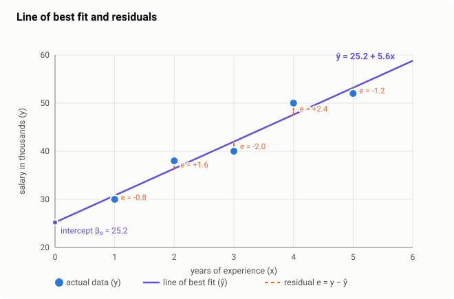
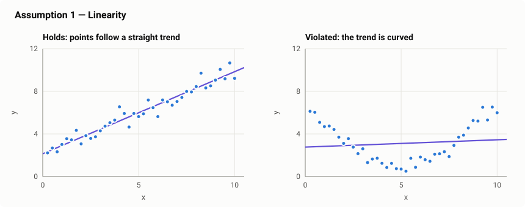
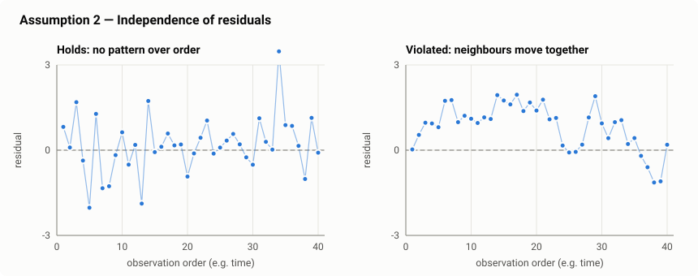
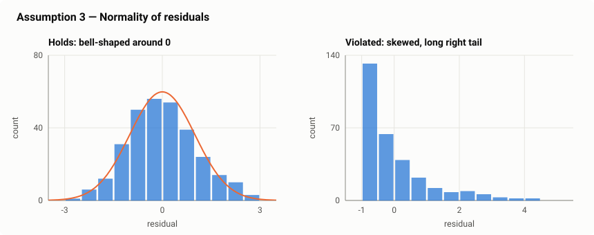
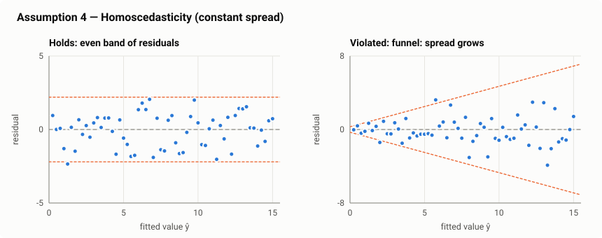
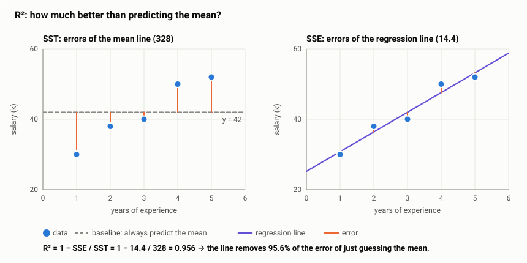
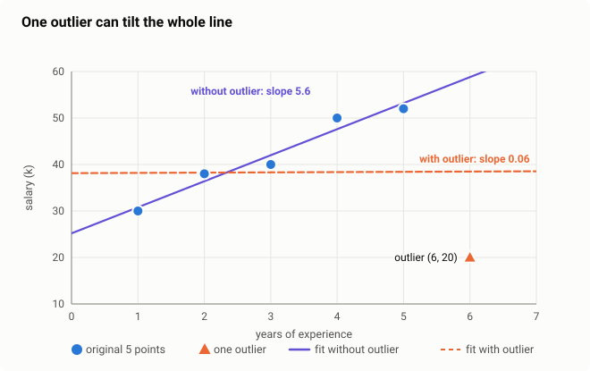
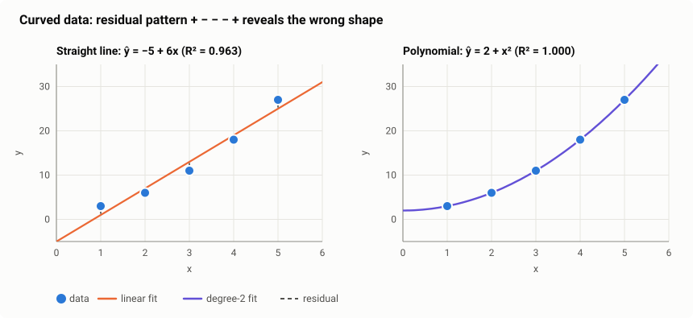

# Linear Regression

## Contents

1. [What is linear regression?](#1-what-is-linear-regression)
2. [Regression vs classification](#2-regression-vs-classification)
3. [The equation and the residual error](#3-the-equation-and-the-residual-error)
4. [Simple linear regression and the line of best fit](#4-simple-linear-regression-and-the-line-of-best-fit)
5. [Multiple linear regression](#5-multiple-linear-regression)
6. [Assumptions of linear regression](#6-assumptions-of-linear-regression)
7. [Mean Squared Error (MSE)](#7-mean-squared-error-mse)
8. [Root Mean Squared Error (RMSE)](#8-root-mean-squared-error-rmse)
9. [R-squared (R²): Coefficient of Determination](#9-r-squared-r-coefficient-of-determination)
10. [MAE and Adjusted R²](#10-mae-and-adjusted-r)
11. [Evaluating on unseen data](#11-evaluating-on-unseen-data)
12. [Training with gradient descent](#12-training-with-gradient-descent)
13. [Preparing features: encoding and scaling](#13-preparing-features-encoding-and-scaling)
14. [Multicollinearity](#14-multicollinearity)
15. [Outliers](#15-outliers)
16. [Polynomial regression](#16-polynomial-regression)
17. [Regularization: Ridge, Lasso, Elastic Net](#17-regularization-ridge-lasso-elastic-net)

---

## 1. What is linear regression?

### Simple definition

**Linear regression** is a supervised learning algorithm that predicts a **continuous number** by fitting a **straight line** (or a flat plane, with more features) through the data.

### Main concept

It assumes that the target $y$ changes at a **constant rate** as the input $x$ changes. For example: every extra year of experience adds roughly the same amount to a salary.

The model learns two things from the data:

- **where the line starts** (the intercept)
- **how steep it is** (the slope)

Once it has the line, it predicts the target for any new input by reading the value off the line.

**Examples:**

- years of experience → salary
- house size and number of bedrooms → house price
- advertising budget → sales
- temperature → electricity usage

---

## 2. Regression vs classification

Both are **supervised learning**: the model learns from examples that come with the correct answers (labels). The difference is **the type of answer** it predicts.

| | **Regression** | **Classification** |
|---|---|---|
| Predicts | a **continuous number** | a **category (class)** |
| Example output | salary = 47.6k, price = 85.3 lakh | spam / not spam, cat / dog / rabbit |
| Question it answers | "**How much?**" / "**How many?**" | "**Which one?**" |
| What the model draws | a line that **passes through** the data | a boundary that **separates** the classes |
| How errors are measured | **distance** from the true value (MSE, RMSE, R²) | **right or wrong** (accuracy, precision, recall, F1) |
| Typical algorithms | linear regression, polynomial regression, regression trees | logistic regression, KNN, SVM, Naive Bayes |

A regression error has a **size**: predicting 48 when the truth is 50 is better than predicting 70. A classification error is simply **right or wrong**.

> **Naming trap:** *logistic regression* is a **classification** algorithm, despite its name.

---

## 3. The equation and the residual error

### The equation

$$
\hat{y} = \beta_0 + \beta_1 x
$$

| Symbol | Name | Meaning |
|---|---|---|
| $x$ | input / feature / independent variable | what we know (e.g. years of experience) |
| $\hat{y}$ ("y-hat") | prediction | what the model outputs |
| $y$ | actual value / target / dependent variable | the true answer |
| $\beta_0$ | **intercept** | the prediction when $x = 0$; where the line crosses the y-axis |
| $\beta_1$ | **slope** (coefficient) | how much $\hat{y}$ changes when $x$ increases by 1 |

The slope tells you the **direction** of the relationship:

| Slope | Relationship |
|---|---|
| $\beta_1 > 0$ | as $x$ goes up, $y$ goes up |
| $\beta_1 < 0$ | as $x$ goes up, $y$ goes down |
| $\beta_1 = 0$ | $x$ has no linear effect on $y$ |

### The residual (error)

The line almost never passes exactly through every point. The **residual** is the gap between the actual value and the predicted value for one data point:

$$
e_i = y_i - \hat{y}_i
$$

| Residual | Meaning |
|---|---|
| $e_i > 0$ | the actual point is **above** the line, so the model **under-predicted** |
| $e_i < 0$ | the actual point is **below** the line, so the model **over-predicted** |
| $e_i = 0$ | the line passes exactly through the point |

On a graph, a residual is the **vertical distance** from a point to the line (the dashed orange segments in the next figure).

The full model, including the error term for the real data, is:

$$
y = \beta_0 + \beta_1 x + \varepsilon
$$

Here $\varepsilon$ represents everything the line cannot explain: random noise, missing factors and measurement error.

---

## 4. Simple linear regression and the line of best fit

### Simple definition

**Simple linear regression** uses **one input feature** to predict the target:

$$
\hat{y} = \beta_0 + \beta_1 x
$$

### The line of best fit

Many lines could be drawn through a scatter of points. The **line of best fit** is the one with the **smallest total squared residual error**:

$$
\text{choose } \beta_0, \beta_1 \text{ to minimise } \sum_{i=1}^{n}\big(y_i - \hat{y}_i\big)^2 = \sum_{i=1}^{n}\big(y_i - \beta_0 - \beta_1 x_i\big)^2
$$

This is called the **Ordinary Least Squares (OLS)** method.

**Why square the residuals?**

1. Positive and negative errors would otherwise **cancel out**: residuals of +5 and −5 would sum to 0, as if the line were perfect.
2. Squaring punishes **big errors more** than small ones, so the line avoids being far from any point.

### The formulas for slope and intercept

Setting the derivatives of the squared error to zero gives exact formulas:

$$
\beta_1 = \frac{\sum_{i=1}^{n}(x_i - \bar{x})(y_i - \bar{y})}{\sum_{i=1}^{n}(x_i - \bar{x})^2}
\qquad
\beta_0 = \bar{y} - \beta_1\bar{x}
$$

where $\bar{x}$ and $\bar{y}$ are the averages of $x$ and $y$.

- The **slope** measures how $x$ and $y$ move together, divided by how much $x$ varies on its own.
- The **intercept** formula guarantees the line always passes through the point $(\bar{x}, \bar{y})$.

### Worked example: experience → salary

| Years of experience $x$ | Salary in thousands $y$ |
|---:|---:|
| 1 | 30 |
| 2 | 38 |
| 3 | 40 |
| 4 | 50 |
| 5 | 52 |

**Step 1 — the means:**

$$
\bar{x} = \frac{1+2+3+4+5}{5} = 3 \qquad \bar{y} = \frac{30+38+40+50+52}{5} = 42
$$

**Step 2 — deviations from the mean:**

| $x$ | $y$ | $x - \bar{x}$ | $y - \bar{y}$ | $(x - \bar{x})(y - \bar{y})$ | $(x - \bar{x})^2$ |
|---:|---:|---:|---:|---:|---:|
| 1 | 30 | −2 | −12 | 24 | 4 |
| 2 | 38 | −1 | −4 | 4 | 1 |
| 3 | 40 | 0 | −2 | 0 | 0 |
| 4 | 50 | 1 | 8 | 8 | 1 |
| 5 | 52 | 2 | 10 | 20 | 4 |
| **Sum** | | | | **56** | **10** |

**Step 3 — slope and intercept:**

$$
\beta_1 = \frac{56}{10} = 5.6 \qquad \beta_0 = 42 - 5.6 \times 3 = 25.2
$$

**The line of best fit:**

$$
\hat{y} = 25.2 + 5.6x
$$

**Interpretation:**

- **Slope 5.6:** each extra year of experience adds about **5.6k** to the salary.
- **Intercept 25.2:** the predicted starting salary with 0 years of experience is **25.2k**.
- **Prediction for 6 years:** $\hat{y} = 25.2 + 5.6 \times 6 = 58.8$k.

**Step 4 — predictions and residuals:**

| $x$ | Actual $y$ | Predicted $\hat{y} = 25.2 + 5.6x$ | Residual $e = y - \hat{y}$ |
|---:|---:|---:|---:|
| 1 | 30 | 30.8 | −0.8 |
| 2 | 38 | 36.4 | +1.6 |
| 3 | 40 | 42.0 | −2.0 |
| 4 | 50 | 47.6 | +2.4 |
| 5 | 52 | 53.2 | −1.2 |
| | | **Sum** | **0.0** |

The residuals of an OLS line with an intercept **always sum to zero**: the line sits in the middle of the points.

### The graph

The blue dots are the actual data, the purple line is $\hat{y} = 25.2 + 5.6x$, and each dashed orange segment is one residual.

---

## 5. Multiple linear regression

### Simple definition

**Multiple linear regression** uses **two or more input features** to predict the target. Real outcomes rarely depend on one thing: a house price depends on size, bedrooms, location, age and more.

### The equation

$$
\hat{y} = \beta_0 + \beta_1 x_1 + \beta_2 x_2 + \dots + \beta_p x_p
$$

| Symbol | Meaning |
|---|---|
| $x_1, \dots, x_p$ | the $p$ input features |
| $\beta_0$ | intercept |
| $\beta_j$ | how much $\hat{y}$ changes when $x_j$ increases by 1, **with all other features held constant** |

With two features the model is a **flat plane** instead of a line. With more features it is a "hyperplane", which can't be drawn but works the same way.

**Matrix form.** Stack all samples into a matrix $X$ (one row per sample, with a first column of 1s for the intercept):

$$
\hat{\mathbf{y}} = X\boldsymbol{\beta}
\qquad\qquad
\boldsymbol{\beta} = (X^\top X)^{-1}X^\top\mathbf{y}
$$

The second formula (the **normal equation**) gives the least-squares coefficients directly. It is the multi-feature version of the slope and intercept formulas from section 4.

### Worked example: house price

| Size (1,000 sq ft) $x_1$ | Bedrooms $x_2$ | Price (lakh) $y$ |
|---:|---:|---:|
| 1 | 2 | 50 |
| 2 | 3 | 65 |
| 3 | 3 | 70 |
| 4 | 4 | 88 |
| 5 | 4 | 92 |
| 6 | 5 | 110 |

Solving the normal equation gives:

$$
\hat{y} = 19.67 + 4.75\,x_1 + 12.25\,x_2
$$

**Interpretation:**

- **4.75:** each extra 1,000 sq ft adds about **4.75 lakh**, for houses with the **same number of bedrooms**.
- **12.25:** each extra bedroom adds about **12.25 lakh**, for houses of the **same size**.

**Predict a new house** with 3,500 sq ft and 4 bedrooms:

$$
\hat{y} = 19.67 + 4.75(3.5) + 12.25(4) = 19.67 + 16.625 + 49.00 \approx 85.29 \text{ lakh}
$$

**Check against the training data:**

| $x_1$ | $x_2$ | Actual $y$ | Predicted $\hat{y}$ | Residual |
|---:|---:|---:|---:|---:|
| 1 | 2 | 50 | 48.92 | +1.08 |
| 2 | 3 | 65 | 65.92 | −0.92 |
| 3 | 3 | 70 | 70.67 | −0.67 |
| 4 | 4 | 88 | 87.67 | +0.33 |
| 5 | 4 | 92 | 92.42 | −0.42 |
| 6 | 5 | 110 | 109.42 | +0.58 |

### Simple vs multiple linear regression

| | Simple | Multiple |
|---|---|---|
| Features | 1 | 2 or more |
| Equation | $\hat{y} = \beta_0 + \beta_1x$ | $\hat{y} = \beta_0 + \beta_1x_1 + \dots + \beta_px_p$ |
| Shape | line | plane / hyperplane |
| Coefficient meaning | change in $\hat{y}$ per unit of $x$ | change in $\hat{y}$ per unit of $x_j$, **others held fixed** |

---

## 6. Assumptions of linear regression

Linear regression gives reliable coefficients, predictions and confidence intervals only when these four assumptions hold. Most are checked by looking at the **residuals** after fitting.

### 6.1 Linearity

**Definition:** the relationship between the features and the target is a **straight line**: a one-unit change in $x$ always changes $y$ by the same amount.

- **How to check:** scatter plot of $y$ vs $x$, or residuals vs predicted values. The residuals should show **no curve**.
- **If violated:** the line systematically misses the pattern. In the right panel it under-predicts at both ends and over-predicts in the middle.
- **Fix:** transform the features (e.g. add $x^2$, use $\log x$), or use a non-linear model.

### 6.2 Independence

**Definition:** the residuals are **independent of each other**. The error on one observation tells you nothing about the error on another.

- **How to check:** plot the residuals in the order the data was collected (e.g. over time). They should jump around randomly. The **Durbin–Watson** test checks this formally (a value near 2 means independent).
- **If violated:** typical with **time-series** data. Today's error is similar to yesterday's (right panel: long runs above and below 0). The coefficients may still be fine, but their standard errors and confidence intervals become wrong, usually too optimistic.
- **Fix:** add time-based features (lags, trends), or use a time-series model.

### 6.3 Normality

**Definition:** the residuals follow a **normal (bell-shaped) distribution** centred at 0.

- **How to check:** a histogram of the residuals, or a **Q-Q plot** (points should lie on a straight diagonal line).
- **If violated:** predictions can still be reasonable, but **p-values and confidence intervals become unreliable**, especially with small datasets. Skewed residuals often point to outliers or a target that needs transforming.
- **Fix:** transform the target (e.g. $\log y$ for prices or incomes), or handle outliers.

### 6.4 Homoscedasticity

**Definition:** the residuals have **constant variance (spread)** across all predicted values. *Homo* means "same" and *scedasticity* means "spread". The opposite is **heteroscedasticity**.

- **How to check:** plot the residuals against the predicted values. They should form an **even horizontal band**. A **funnel** shape (right panel) is a violation.
- **If violated:** common with money values: predicting a 10-lakh flat is usually off by less than predicting a 10-crore mansion. The model's uncertainty estimates become wrong: too confident for large values, too cautious for small ones.
- **Fix:** transform the target (e.g. $\log y$), or use weighted least squares.

### Summary

| Assumption | Meaning | Checked with | Good sign |
|---|---|---|---|
| **Linearity** | $y$ changes linearly with $x$ | scatter plot, residuals vs predicted | no curve |
| **Independence** | residuals don't depend on each other | residuals vs order / time | random, no runs |
| **Normality** | residuals are bell-shaped around 0 | histogram, Q-Q plot | symmetric bell |
| **Homoscedasticity** | residual spread is constant | residuals vs predicted | even band, no funnel |

---

## 7. Mean Squared Error (MSE)

### Definition

**MSE** is the **average of the squared residuals**. It measures how far the predictions are from the actual values, on average. It is also the quantity that OLS minimises when it finds the line of best fit.

$$
\text{MSE} = \frac{1}{n}\sum_{i=1}^{n}\big(y_i - \hat{y}_i\big)^2
$$

### Simple math: the salary example

| $x$ | Residual $e$ | Squared residual $e^2$ |
|---:|---:|---:|
| 1 | −0.8 | 0.64 |
| 2 | +1.6 | 2.56 |
| 3 | −2.0 | 4.00 |
| 4 | +2.4 | 5.76 |
| 5 | −1.2 | 1.44 |
| | **Sum (SSE)** | **14.40** |

$$
\text{MSE} = \frac{14.40}{5} = 2.88
$$

### Properties

- **Lower is better.** 0 means a perfect fit.
- **Units are squared.** Salary is in thousands, so the MSE is in "thousands squared", which is hard to interpret directly.
- **Sensitive to outliers.** Squaring makes one big error dominate. A residual of 10 contributes 100, as much as a hundred residuals of 1.

---

## 8. Root Mean Squared Error (RMSE)

### Definition

**RMSE** is the **square root of the MSE**. It brings the error back to the **same units as the target**, so it reads as "the typical size of a prediction error".

$$
\text{RMSE} = \sqrt{\text{MSE}} = \sqrt{\frac{1}{n}\sum_{i=1}^{n}\big(y_i - \hat{y}_i\big)^2}
$$

### Simple math: the salary example

$$
\text{RMSE} = \sqrt{2.88} = 1.70
$$

**Interpretation:** the model's salary predictions are typically off by about **1.7k**.

For the house-price model in section 5: $\text{MSE} = 0.514$, so $\text{RMSE} = \sqrt{0.514} = 0.72$ lakh.

### MSE vs RMSE

| | MSE | RMSE |
|---|---|---|
| Formula | $\frac{1}{n}\sum e_i^2$ | $\sqrt{\text{MSE}}$ |
| Units | target units **squared** | **same** as the target |
| Salary example | 2.88 | 1.70k |
| Best used for | training (smooth, easy to differentiate) | reporting (easy to understand) |

Both rank models in the same order: the model with the lower MSE also has the lower RMSE.

---

## 9. R-squared (R²): Coefficient of Determination

### Definition

**R²** measures **what fraction of the variation in $y$ is explained by the model**. It compares the model with the simplest possible baseline: **always predicting the mean** $\bar{y}$.

$$
R^2 = 1 - \frac{\text{SSE}}{\text{SST}} = 1 - \frac{\sum_{i}(y_i - \hat{y}_i)^2}{\sum_{i}(y_i - \bar{y})^2}
$$

| Term | Name | Meaning |
|---|---|---|
| $\text{SSE} = \sum (y_i - \hat{y}_i)^2$ | Sum of Squared Errors (residual sum of squares) | error that **remains** after using the model |
| $\text{SST} = \sum (y_i - \bar{y})^2$ | Total Sum of Squares | total error if we just predict the mean every time |

### Simple math: the salary example

**SST** (errors when always predicting $\bar{y} = 42$):

$$
\text{SST} = (30-42)^2 + (38-42)^2 + (40-42)^2 + (50-42)^2 + (52-42)^2 = 144 + 16 + 4 + 64 + 100 = 328
$$

**SSE** (errors of the regression line, from section 7): $14.4$

$$
R^2 = 1 - \frac{14.4}{328} = 1 - 0.044 = 0.956
$$

**Interpretation:** years of experience explains **95.6%** of the variation in salary. The remaining 4.4% comes from other factors or noise.

For the house-price model in section 5, $R^2 = 0.999$.

### How to read R²

| R² | Meaning |
|---|---|
| **1** | perfect fit: every point lies on the line |
| **close to 1** (e.g. 0.95) | the model explains most of the variation |
| **0** | the model is no better than predicting the mean |
| **negative** | the model is **worse** than predicting the mean (possible on test data) |

### Things to remember

- R² has **no units**, so it is easy to compare across problems. RMSE tells you the error size in real units, so report both.
- A **high R² does not prove the model is correct**: a curved relationship can still give a fairly high R² with a straight line, so check the assumptions too.
- Adding more features **never lowers R²** on the training data, even useless ones. Judge it on test data.

### All three metrics on the salary example

| Metric | Formula | Value | Meaning |
|---|---|---:|---|
| **MSE** | $\frac{1}{n}\sum(y_i - \hat{y}_i)^2$ | 2.88 | average squared error (thousands²) |
| **RMSE** | $\sqrt{\text{MSE}}$ | 1.70 | typical error is about 1.7k |
| **R²** | $1 - \frac{\text{SSE}}{\text{SST}}$ | 0.956 | the model explains 95.6% of the variation |

---

## 10. MAE and Adjusted R²

### Mean Absolute Error (MAE)

**Definition:** the **average of the absolute residuals**, i.e. the average size of the error, ignoring its sign.

$$
\text{MAE} = \frac{1}{n}\sum_{i=1}^{n}\lvert y_i - \hat{y}_i \rvert
$$

**Salary example:**

$$
\text{MAE} = \frac{0.8 + 1.6 + 2.0 + 2.4 + 1.2}{5} = \frac{8.0}{5} = 1.6
$$

The predictions are off by **1.6k on average**.

| | MAE | RMSE |
|---|---|---|
| Salary example | 1.60 | 1.70 |
| Units | same as the target | same as the target |
| Big errors | counted **proportionally** | punished **more** (squared first) |
| Outliers | **robust** | sensitive |

RMSE is always ≥ MAE. A large gap between them means a few predictions have very large errors.

### Adjusted R²

**Problem with R²:** adding *any* feature, even pure noise, never lowers R² on the training data. So R² rewards stuffing the model with features.

**Adjusted R²** adds a penalty for each extra feature:

$$
R^2_{\text{adj}} = 1 - (1 - R^2)\,\frac{n - 1}{n - p - 1}
$$

where $n$ is the number of samples and $p$ the number of features.

| Model | $n$ | $p$ | R² | Adjusted R² |
|---|---:|---:|---:|---:|
| Salary (section 4) | 5 | 1 | 0.956 | $1 - 0.044 \times \frac{4}{3} = 0.941$ |
| House price (section 5) | 6 | 2 | 0.9987 | $1 - 0.0013 \times \frac{5}{3} = 0.998$ |

A new feature raises adjusted R² only if it improves the fit **more than expected by chance**. Use it to compare multiple-regression models with different numbers of features.

---

## 11. Evaluating on unseen data

All the metrics above were computed on the **same data the model was trained on**, which makes them optimistic. What matters is how the model does on **new data**.

**Standard practice:** split the data into a **training set** (fit the model) and a **test set** (compute MSE, RMSE, MAE, R²), for example 80% / 20%.

**Example:** fit the salary model on the first 4 points only, then test on the 5th.

$$
\text{fitted on } x = 1..4: \quad \hat{y} = 24.0 + 6.2x
$$

| | Data | RMSE |
|---|---|---:|
| Training | $x = 1, 2, 3, 4$ | 1.64 |
| Test | $x = 5$: predicted 55.0, actual 52 | **3.00** |

The test error is almost double the training error. That is normal; the **test** number is the one to report.

| Train error | Test error | Diagnosis |
|---|---|---|
| high | high | **underfitting**: the model is too simple (e.g. a line for curved data) |
| low | much higher | **overfitting**: the model memorised the training data |
| low | low (similar) | good fit |

---

## 12. Training with gradient descent

The formulas in section 4 (and the normal equation in section 5) solve linear regression **exactly in one step**. In ML practice the same model is often trained with **gradient descent**: start with any coefficients and repeatedly nudge them downhill on the MSE.

### The gradients

$$
\text{MSE} = \frac{1}{n}\sum_{i=1}^{n}\big(y_i - (\beta_0 + \beta_1x_i)\big)^2
$$

$$
\frac{\partial\,\text{MSE}}{\partial \beta_0} = -\frac{2}{n}\sum_{i=1}^{n}(y_i - \hat{y}_i)
\qquad
\frac{\partial\,\text{MSE}}{\partial \beta_1} = -\frac{2}{n}\sum_{i=1}^{n}(y_i - \hat{y}_i)\,x_i
$$

**Update rule** with learning rate $\eta$:

$$
\beta_0 \leftarrow \beta_0 - \eta\,\frac{\partial\,\text{MSE}}{\partial \beta_0}
\qquad
\beta_1 \leftarrow \beta_1 - \eta\,\frac{\partial\,\text{MSE}}{\partial \beta_1}
$$

### Worked example: salary data, starting from $\beta_0 = \beta_1 = 0$, $\eta = 0.05$

At the start every prediction is 0, so every residual equals $y$: $\sum y_i = 210$ and $\sum y_ix_i = 686$.

$$
\frac{\partial\,\text{MSE}}{\partial \beta_0} = -\frac{2}{5}(210) = -84
\qquad
\frac{\partial\,\text{MSE}}{\partial \beta_1} = -\frac{2}{5}(686) = -274.4
$$

$$
\beta_0 = 0 - 0.05(-84) = 4.2 \qquad \beta_1 = 0 - 0.05(-274.4) = 13.72
$$

| Steps | $\beta_0$ | $\beta_1$ | MSE |
|---:|---:|---:|---:|
| 0 | 0.00 | 0.00 | 1829.6 |
| 1 | 4.20 | 13.72 | 146.0 |
| 10 | 6.68 | 10.73 | 65.3 |
| 100 | 21.21 | 6.71 | 5.78 |
| 1000 | **25.20** | **5.60** | **2.88** |

It reaches exactly the same line as the formula: $\hat{y} = 25.2 + 5.6x$.

### Normal equation vs gradient descent

| | Normal equation $\boldsymbol{\beta} = (X^\top X)^{-1}X^\top\mathbf{y}$ | Gradient descent |
|---|---|---|
| Steps | one exact calculation | many iterations |
| Hyperparameters | none | learning rate, number of iterations |
| Feature scaling | not needed | **needed** for fast convergence |
| Many features (e.g. 100,000) | slow: inverting $X^\top X$ costs about $p^3$ | scales well |
| Huge datasets | needs all data in memory | works in mini-batches |

---

## 13. Preparing features: encoding and scaling

### Categorical features: one-hot encoding

Linear regression needs numbers. A category like `location ∈ {Dhaka, Khulna, Chittagong}` can't be coded as 1, 2, 3, because that would claim Chittagong is "3 times" Dhaka. Instead, create one **0/1 column per category**:

| location | is_Khulna | is_Chittagong |
|---|---:|---:|
| Dhaka | 0 | 0 |
| Khulna | 1 | 0 |
| Chittagong | 0 | 1 |

$$
\hat{y} = \beta_0 + \beta_1\,\text{size} + \beta_2\,\text{is\_Khulna} + \beta_3\,\text{is\_Chittagong}
$$

$\beta_2$ then means "price difference between Khulna and Dhaka for the same size". Dhaka is the **reference category**, included in the intercept.

**Dummy-variable trap:** use **$k - 1$ columns for $k$ categories**. With all 3 columns, they always add up to 1, which duplicates the intercept column. The features become perfectly collinear, $X^\top X$ cannot be inverted, and the coefficients have no unique solution. (`drop_first=True` in pandas, `drop="first"` in scikit-learn.)

### Feature scaling

| Method | Formula | Result |
|---|---|---|
| **Standardization** | $z = \frac{x - \mu}{\sigma}$ | mean 0, standard deviation 1 |
| **Min-max normalization** | $x' = \frac{x - x_{\min}}{x_{\max} - x_{\min}}$ | range [0, 1] |

- Plain OLS predictions **don't change** with scaling (only the coefficients' size changes).
- Scaling **is needed** for gradient descent (section 12) and regularization (section 17), and to **compare coefficients**: in raw units, a coefficient for "size in sq ft" and one for "bedrooms" can't be compared.
- Fit the scaler on the **training set only**, then apply it to the test set.

---

## 14. Multicollinearity

### Definition

**Multicollinearity** means two or more input features are **strongly correlated with each other**. The model then can't tell which feature is responsible for the effect.

### Example

In the house data from section 5, size and bedrooms move together (bigger houses have more bedrooms):

$$
\text{correlation(size, bedrooms)} = 0.968
$$

### Why it's a problem

- **Predictions** are still fine.
- **Coefficients become unstable:** a small change in the data can swing them a lot, even flip their signs. The interpretation "+12.25 lakh per bedrooms, same size" becomes unreliable, because the data barely contains houses that differ in bedrooms but not size.

### How to detect it: VIF

The **Variance Inflation Factor** for feature $j$ is:

$$
\text{VIF}_j = \frac{1}{1 - R_j^2}
$$

where $R_j^2$ is the R² from predicting feature $j$ using the *other* features.

House example: $R^2 = 0.968^2 = 0.938$, so

$$
\text{VIF} = \frac{1}{1 - 0.938} = 16.0
$$

| VIF | Meaning |
|---|---|
| 1 | no correlation with other features |
| 1–5 | moderate, usually fine |
| > 10 | **serious** multicollinearity |

### Fixes

Drop one of the correlated features, combine them (e.g. "size per bedroom"), or use **Ridge regression** (section 17).

---

## 15. Outliers

### Definition

An **outlier** is a data point far away from the general pattern, caused by a data-entry error, a rare event, or a genuinely unusual case.

### Why linear regression is sensitive

OLS minimizes **squared** residuals, so a point with a residual of 30 counts as much as **900** points with a residual of 1. The line tilts toward the outlier.

**Example:** add one point, $(6, 20)$ (6 years of experience, 20k salary), to the salary data:

| | Slope $\beta_1$ | Intercept $\beta_0$ |
|---|---:|---:|
| Original 5 points | 5.60 | 25.2 |
| With the one outlier | **0.06** | 38.1 |

One bad point turned "experience strongly increases salary" into "experience has almost no effect".

### What to do

1. **Investigate first:** is it a typo (e.g. 20 instead of 200)? Fix or remove it.
2. If it is real, keep it, and consider **MAE / Huber loss** or a log transform of the target, which reduce its influence.
3. Look for outliers with a scatter plot or residual plot; standardized residuals beyond about ±3 deserve a check.

---

## 16. Polynomial regression

### Definition

When the relationship is **curved** (the linearity assumption fails), add powers of $x$ as new features:

$$
\hat{y} = \beta_0 + \beta_1x + \beta_2x^2 + \dots + \beta_dx^d
$$

This is **still linear regression**: the model is linear in the **coefficients** $\beta$. We just feed it the extra features $x^2, x^3, \dots$ and solve with the same OLS method.

### Example

Data: $x = (1, 2, 3, 4, 5)$, $y = (3, 6, 11, 18, 27)$.

| Model | Equation | Residuals | R² |
|---|---|---|---:|
| Straight line | $\hat{y} = -5 + 6x$ | +2, −1, −2, −1, +2 | 0.963 |
| Degree 2 | $\hat{y} = 2 + x^2$ | 0, 0, 0, 0, 0 | 1.000 |

**Lesson:** the straight line still has a high R² (0.963), but its residuals follow a clear **+ − − − +** pattern. Patterned residuals mean the model has the wrong shape, whatever R² says.

### Choosing the degree

| Degree | Risk |
|---|---|
| Too low | underfitting: misses the curve |
| Too high | overfitting: wiggles through the noise and fails on new data |

Choose the degree using **test or validation error**, not training error, since training error always drops as the degree rises.

---

## 17. Regularization: Ridge, Lasso, Elastic Net

### Definition

**Regularization** adds a **penalty on the size of the coefficients** to the loss. The model must balance "fit the data" against "keep the coefficients small", which reduces overfitting and stabilizes coefficients under multicollinearity.

| Model | Loss to minimize | Effect |
|---|---|---|
| **OLS** | $\sum(y_i - \hat{y}_i)^2$ | no penalty |
| **Ridge (L2)** | $\sum(y_i - \hat{y}_i)^2 + \lambda\sum_j \beta_j^2$ | shrinks all coefficients toward 0, never exactly 0 |
| **Lasso (L1)** | $\sum(y_i - \hat{y}_i)^2 + \lambda\sum_j \lvert\beta_j\rvert$ | can set coefficients **exactly to 0**, which works as automatic **feature selection** |
| **Elastic Net** | $\sum(y_i - \hat{y}_i)^2 + \lambda_1\sum_j \lvert\beta_j\rvert + \lambda_2\sum_j \beta_j^2$ | mix of both: sparse and stable with correlated features |

$\lambda$ controls the strength. $\lambda = 0$ gives plain OLS; a very large $\lambda$ pushes the coefficients toward 0 (underfitting). The intercept $\beta_0$ is **not** penalized.

### Worked example: Ridge on the salary data

For one feature, the Ridge slope has a simple formula: the penalty is added to the denominator of the OLS slope.

$$
\beta_1^{\text{ridge}} = \frac{\sum(x_i - \bar{x})(y_i - \bar{y})}{\sum(x_i - \bar{x})^2 + \lambda} = \frac{56}{10 + \lambda}
$$

| $\lambda$ | Slope $\beta_1$ | Intercept $\beta_0 = 42 - 3\beta_1$ |
|---:|---:|---:|
| 0 (OLS) | 5.60 | 25.2 |
| 5 | 3.73 | 30.8 |
| 10 | 2.80 | 33.6 |
| 50 | 0.93 | 39.2 |

As $\lambda$ grows, the slope shrinks toward 0 and the line flattens toward the mean $\bar{y} = 42$.

### Practical rules

- **Scale the features first.** The penalty treats all coefficients equally, so features must be on the same scale.
- **Choose $\lambda$ with cross-validation**, not on the test set.
- **Which one:**

| Situation | Use |
|---|---|
| Many useful, correlated features | **Ridge** |
| Many features, only some matter | **Lasso** |
| Many correlated features, want some selection | **Elastic Net** |
