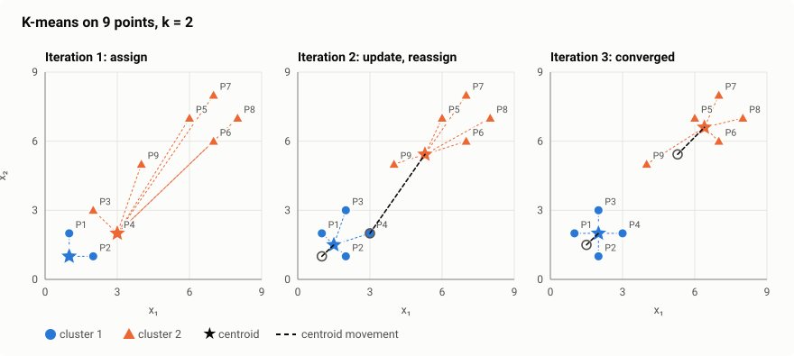
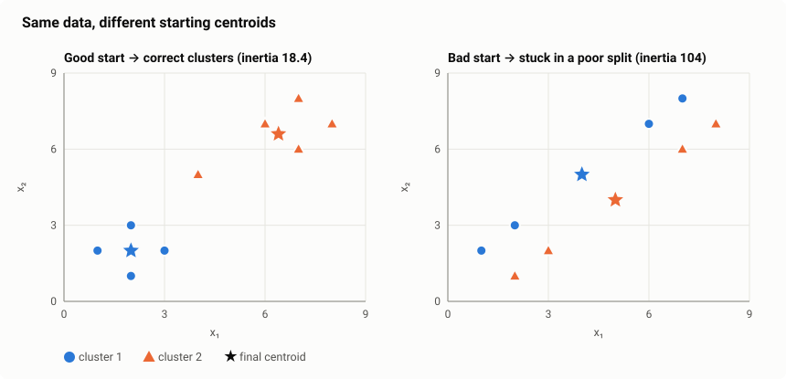
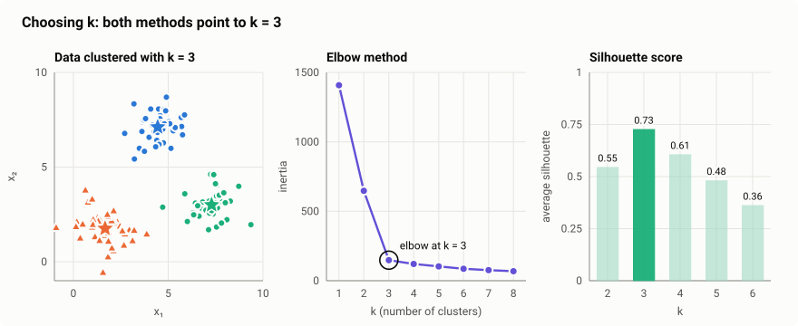
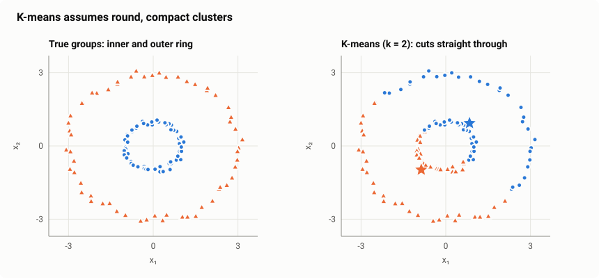
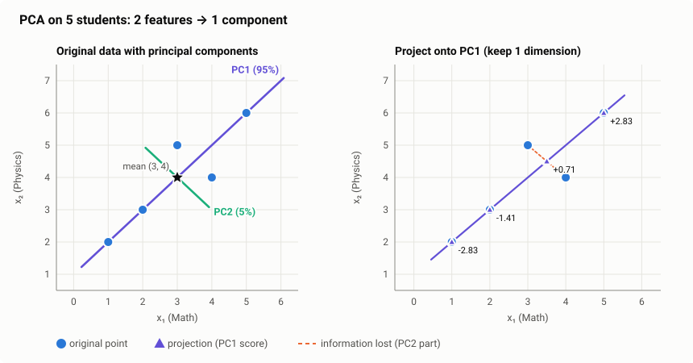
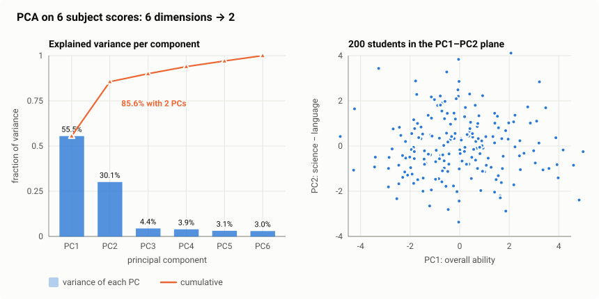

# K-Means Clustering and Principal Component Analysis (PCA)

## Contents

1. [Unsupervised learning](#1-unsupervised-learning)

**Part A — K-Means Clustering**

2. [What is K-means?](#2-what-is-k-means)
3. [How K-means works](#3-how-k-means-works)
4. [Worked example: K-means by hand](#4-worked-example-k-means-by-hand)
5. [Initialization and K-means++](#5-initialization-and-k-means)
6. [Choosing k: elbow method and silhouette score](#6-choosing-k-elbow-method-and-silhouette-score)
7. [K-means in practice: scaling, limits and uses](#7-k-means-in-practice-scaling-limits-and-uses)

**Part B — Principal Component Analysis**

8. [What is PCA?](#8-what-is-pca)
9. [The math behind PCA](#9-the-math-behind-pca)
10. [Worked example: PCA by hand](#10-worked-example-pca-by-hand)
11. [Choosing the number of components](#11-choosing-the-number-of-components)
12. [PCA in practice: scaling, limits and uses](#12-pca-in-practice-scaling-limits-and-uses)
13. [K-means vs PCA](#13-k-means-vs-pca)

---

## 1. Unsupervised learning

Both K-means and PCA are **unsupervised learning** algorithms: they work on data **without labels**. There is no "correct answer" column to learn from. The goal is to discover **structure** hidden in the features.

| Task | Question | Algorithm in this note |
|---|---|---|
| **Clustering** | which data points naturally belong together? | **K-means** |
| **Dimensionality reduction** | can we describe the data with fewer features without losing much information? | **PCA** |

---

# Part A — K-Means Clustering

## 2. What is K-means?

### Simple definition

**K-means** splits the data into **k groups (clusters)** so that points in the same cluster are **close to each other**. Each cluster is represented by its centre, called the **centroid**: the average of all its points.

### What problem it solves

You have data but no labels, and you want to find natural groups in it:

| Domain | Example |
|---|---|
| Marketing | **customer segmentation**: group customers by spending and visit frequency |
| Images | **colour compression**: replace millions of colours with the k most typical ones |
| Documents | group news articles or support tickets by topic (on text embeddings) |
| Operations | group stores, delivery zones or sensors with similar behaviour |
| Anomaly detection | points far from every centroid are unusual |

### Key terms

| Term | Meaning |
|---|---|
| **k** | number of clusters; **you choose it** before running |
| **Centroid** | the centre (mean) of a cluster |
| **Assignment** | which cluster each point belongs to |
| **Inertia (WCSS)** | Within-Cluster Sum of Squares: the total squared distance of points to their centroid. Lower means tighter clusters. |

---

## 3. How K-means works

### The algorithm

1. **Choose k.**
2. **Initialize** k centroids (for example, pick k random data points).
3. **Assignment step:** assign every point to its **nearest centroid**.
4. **Update step:** move each centroid to the **mean** of the points assigned to it.
5. **Repeat** steps 3–4 until the assignments stop changing (**convergence**).

### The math

**Distance** (Euclidean) between a point $\mathbf{x}$ and a centroid $\boldsymbol{\mu}$:

$$
d(\mathbf{x}, \boldsymbol{\mu}) = \sqrt{(x_1 - \mu_1)^2 + (x_2 - \mu_2)^2 + \dots + (x_d - \mu_d)^2}
$$

**Assignment step**: point $i$ goes to the cluster with the closest centroid:

$$
c_i = \arg\min_{j}\ \lVert \mathbf{x}_i - \boldsymbol{\mu}_j \rVert^2
$$

**Update step**: the new centroid is the mean of its $n_j$ points:

$$
\boldsymbol{\mu}_j = \frac{1}{n_j}\sum_{i \in \text{cluster } j}\mathbf{x}_i
$$

**Objective** that K-means minimizes, the **inertia**:

$$
J = \sum_{j=1}^{k}\ \sum_{i \in \text{cluster } j}\lVert \mathbf{x}_i - \boldsymbol{\mu}_j \rVert^2
$$

**Why it always converges:**

- The assignment step can only lower $J$, because each point moves to a closer centroid.
- The update step can only lower $J$, because the mean is the point with the smallest total squared distance to a group.

$J$ never increases, and there are only finitely many ways to assign points, so the algorithm must stop. It may stop at a **local** minimum rather than the best one, though (section 5).

---

## 4. Worked example: K-means by hand

**Data:** 9 customers described by two features (e.g. $x_1$ = visits per month, $x_2$ = spend per visit, both on a small scale).

| Point | P1 | P2 | P3 | P4 | P5 | P6 | P7 | P8 | P9 |
|---|---|---|---|---|---|---|---|---|---|
| $(x_1, x_2)$ | (1, 2) | (2, 1) | (2, 3) | (3, 2) | (6, 7) | (7, 6) | (7, 8) | (8, 7) | (4, 5) |

**Settings:** $k = 2$, initial centroids $C_1 = (1, 1)$ and $C_2 = (3, 2)$.

### Iteration 1

**Assignment step.** Distance from each point to each centroid, for example for P3:

$$
d(P3, C_1) = \sqrt{(2-1)^2 + (3-1)^2} = \sqrt{5} = 2.24 \qquad d(P3, C_2) = \sqrt{(2-3)^2 + (3-2)^2} = \sqrt{2} = 1.41
$$

so P3 goes to $C_2$.

| Point | Distance to $C_1 = (1, 1)$ | Distance to $C_2 = (3, 2)$ | Cluster |
|---|---:|---:|:---:|
| P1 (1, 2) | **1.00** | 2.00 | 1 |
| P2 (2, 1) | **1.00** | 1.41 | 1 |
| P3 (2, 3) | 2.24 | **1.41** | 2 |
| P4 (3, 2) | 2.24 | **0.00** | 2 |
| P5 (6, 7) | 7.81 | **5.83** | 2 |
| P6 (7, 6) | 7.81 | **5.66** | 2 |
| P7 (7, 8) | 9.22 | **7.21** | 2 |
| P8 (8, 7) | 9.22 | **7.07** | 2 |
| P9 (4, 5) | 5.00 | **3.16** | 2 |

**Update step.** New centroids are the means of their points:

$$
C_1 = \left(\frac{1+2}{2},\ \frac{2+1}{2}\right) = (1.5,\ 1.5)
$$

$$
C_2 = \left(\frac{2+3+6+7+7+8+4}{7},\ \frac{3+2+7+6+8+7+5}{7}\right) = \left(\frac{37}{7},\ \frac{38}{7}\right) = (5.29,\ 5.43)
$$

### Iteration 2

| Point | Distance to $C_1 = (1.5, 1.5)$ | Distance to $C_2 = (5.29, 5.43)$ | Cluster |
|---|---:|---:|:---:|
| P1 (1, 2) | **0.71** | 5.49 | 1 |
| P2 (2, 1) | **0.71** | 5.51 | 1 |
| P3 (2, 3) | **1.58** | 4.09 | **1** (switched) |
| P4 (3, 2) | **1.58** | 4.12 | **1** (switched) |
| P5 (6, 7) | 7.11 | **1.73** | 2 |
| P6 (7, 6) | 7.11 | **1.81** | 2 |
| P7 (7, 8) | 8.51 | **3.09** | 2 |
| P8 (8, 7) | 8.51 | **3.14** | 2 |
| P9 (4, 5) | 4.30 | **1.36** | 2 |

P3 and P4 move to cluster 1, because $C_2$ was pulled away toward the upper group.

**Update step:**

$$
C_1 = \left(\frac{1+2+2+3}{4},\ \frac{2+1+3+2}{4}\right) = (2.0,\ 2.0)
\qquad
C_2 = \left(\frac{6+7+7+8+4}{5},\ \frac{7+6+8+7+5}{5}\right) = (6.4,\ 6.6)
$$

### Iteration 3

Recomputing the distances gives **the same assignments**, so the centroids don't move. **Converged.**

| Cluster | Points | Centroid |
|---|---|---|
| 1 | P1, P2, P3, P4 | (2.0, 2.0) |
| 2 | P5, P6, P7, P8, P9 | (6.4, 6.6) |

### Inertia of the final clustering

Squared distance from each point to its own centroid:

| Point | P1 | P2 | P3 | P4 | P5 | P6 | P7 | P8 | P9 |
|---|---:|---:|---:|---:|---:|---:|---:|---:|---:|
| $\lVert \mathbf{x} - \boldsymbol{\mu} \rVert^2$ | 1.00 | 1.00 | 1.00 | 1.00 | 0.32 | 0.72 | 2.32 | 2.72 | 8.32 |

For example, P9: $(4 - 6.4)^2 + (5 - 6.6)^2 = 5.76 + 2.56 = 8.32$.

$$
J = 4 \times 1.00 + 0.32 + 0.72 + 2.32 + 2.72 + 8.32 = 18.4
$$

The inertia fell at each iteration: **62.1 → 18.4 → 18.4** (no change, so stop).

---

## 5. Initialization and K-means++

### The problem: local minima

K-means always converges, but **where** it ends up depends on the starting centroids. Run the same 9 points with the initial centroids $(1, 2)$ and $(2, 1)$, both inside the lower-left group:

| Start | Final centroids | Inertia | Result |
|---|---|---:|---|
| $(1, 1)$ and $(3, 2)$ | (2.0, 2.0) and (6.4, 6.6) | **18.4** | correct groups |
| $(1, 2)$ and $(2, 1)$ | (4.0, 5.0) and (5.0, 4.0) | 104.0 | a nonsense diagonal split |

The bad start gets **stuck**: each step is locally optimal, but the result is more than 5× worse.

### The fixes

**1. Run it several times** with different random starts and keep the result with the **lowest inertia** (`n_init` in scikit-learn).

**2. K-means++ initialization** (the default in scikit-learn). It spreads the starting centroids out:

1. Pick the first centroid at random from the data.
2. For every point, compute $D(\mathbf{x})$, its distance to the **nearest already-chosen centroid**.
3. Pick the next centroid at random, with probability proportional to $D(\mathbf{x})^2$:

$$
P(\mathbf{x}) = \frac{D(\mathbf{x})^2}{\sum_{\mathbf{x}'} D(\mathbf{x}')^2}
$$

4. Repeat until there are k centroids.

Points far from the existing centroids are much more likely to be chosen, so the starting centroids land in different groups. In the example, if P1 is chosen first, P8 has $D^2 = 49 + 25 = 74$ while P2 has $D^2 = 2$. P8 is **37× more likely** to be picked as the second centroid.

---

## 6. Choosing k: elbow method and silhouette score

K-means needs k in advance, but with unlabelled data the right k is unknown. Two standard tools help. The examples below use 120 points generated around 3 centres.

### Elbow method

Run K-means for k = 1, 2, 3, … and plot the inertia.

| k | 1 | 2 | **3** | 4 | 5 | 6 | 7 | 8 |
|---|---:|---:|---:|---:|---:|---:|---:|---:|
| Inertia | 1408.1 | 647.4 | **148.0** | 120.7 | 103.2 | 85.9 | 76.2 | 68.2 |
| Drop from previous k | — | 760.7 | **499.4** | 27.3 | 17.5 | 17.3 | 9.7 | 8.0 |

- Inertia **always** decreases as k grows; with k = n, every point is its own cluster and inertia is 0. So you can't just pick the lowest.
- Look for the **elbow**: the k after which adding more clusters gives only small improvements. Here the drop collapses from 499 to 27 after **k = 3**.
- **Weakness:** the elbow is often not sharp, so the choice can be subjective.

### Silhouette score

For each point $i$, compare how close it is to **its own cluster** with how close it is to the **nearest other cluster**:

| Quantity | Meaning |
|---|---|
| $a(i)$ | average distance from $i$ to the other points **in its own cluster** |
| $b(i)$ | average distance from $i$ to the points in the **nearest other cluster** |

$$
s(i) = \frac{b(i) - a(i)}{\max\big(a(i),\ b(i)\big)}
$$

| $s(i)$ | Meaning |
|---|---|
| close to **+1** | well inside its cluster, far from the others |
| around **0** | on the border between two clusters |
| **negative** | probably in the wrong cluster |

**Worked example on the 9 points** (final clustering from section 4):

**P1 (1, 2)**, cluster 1:

$$
a = \frac{d(P1,P2) + d(P1,P3) + d(P1,P4)}{3} = \frac{1.41 + 1.41 + 2.00}{3} = 1.61
$$

$$
b = \text{average distance to P5, P6, P7, P8, P9} = 7.12
\qquad
s = \frac{7.12 - 1.61}{7.12} = 0.77
$$

P1 is clearly in the right cluster.

**P9 (4, 5)**, cluster 2: $a = 3.68$ and $b = 3.68$, so $s = 0$. P9 sits **exactly between** the two groups, as you can see in the figure.

The **average silhouette** over all points is the overall score. For the 9 points it is **0.64**.

**For choosing k**, compute the average silhouette for each k and pick the highest. On the 3-centre data:

| k | 2 | **3** | 4 | 5 | 6 |
|---|---:|---:|---:|---:|---:|
| Average silhouette | 0.55 | **0.73** | 0.61 | 0.48 | 0.36 |

Both methods agree: **k = 3**. In real projects, also check that the clusters **make sense for the business**: three customer segments you can name and act on beat five that nobody can explain.

---

## 7. K-means in practice: scaling, limits and uses

### Always scale the features

K-means is distance-based, so a feature with large numbers dominates. With income (20,000–200,000) and age (18–80), the clusters would be decided almost entirely by income. **Standardize** each feature first: $z = \frac{x - \mu}{\sigma}$.

### Limitations

| Limitation | Why | What to use instead |
|---|---|---|
| Must choose **k** in advance | k is an input | elbow / silhouette; or DBSCAN, which finds the number itself |
| Assumes **round, similar-sized** clusters | every point simply goes to the nearest centre | DBSCAN, Gaussian Mixture Models, spectral clustering |
| **Sensitive to outliers** | the centroid is a mean, and one far point pulls it | remove outliers first, or use K-medoids |
| Depends on **initialization** | local minima (section 5) | K-means++ and several runs |
| Only **numeric** features | needs means and Euclidean distances | K-modes for categorical data |

**Example of the shape problem:** two rings, one inside the other. The groups are obvious to a human, but K-means cuts the data straight down the middle, because it can only draw straight boundaries between centroids.

### Cost

Each iteration computes the distance from $n$ points to $k$ centroids in $d$ dimensions, which costs $O(n \cdot k \cdot d)$. Usually only a few dozen iterations are needed, so K-means is **fast and scales to large datasets**. For very large data, **Mini-batch K-means** updates the centroids from small random batches.

### Assigning new data

After training, a new point is assigned to the **nearest centroid**, a single distance calculation per centroid. That makes K-means easy to use in production, for example to place a new customer into an existing segment.

---

# Part B — Principal Component Analysis

## 8. What is PCA?

### Simple definition

**Principal Component Analysis (PCA)** transforms the data into a new set of features, called **principal components**. They are ordered so that the **first component captures the most variation** in the data, the second captures the most of what remains, and so on. Keeping only the first few components **reduces the number of features** while keeping most of the information.

### Intuition

Imagine photographing a 3-D object. Some camera angles show its shape clearly; others hide it. PCA finds the **best viewing angles** for the data: the directions along which the data is most **spread out**, because spread is where the information is.

If two features are strongly correlated, such as height in cm and height in inches, or Math and Physics marks, they mostly say the same thing. PCA combines them into one component.

### What problem it solves

| Problem | How PCA helps |
|---|---|
| **Too many features** (hundreds or thousands) | keep a few components that hold most of the information |
| **Correlated / redundant features** | the components are **uncorrelated** with each other |
| **Can't visualize** high-dimensional data | project onto 2 components and plot it |
| **Slow training, overfitting** | fewer inputs mean faster, simpler models |
| **Noise** | dropping the low-variance components often removes noise |
| **Curse of dimensionality** (e.g. for KNN, K-means) | distances become meaningful again in fewer dimensions |

### Key terms

| Term | Meaning |
|---|---|
| **Principal component (PC)** | a new axis: a direction in feature space, written as a weighted combination of the original features |
| **Loadings** | the weights of the original features in a component |
| **Explained variance** | how much of the data's total variance a component captures |
| **Scores** | the coordinates of each data point along the components (the transformed data) |

---

## 9. The math behind PCA

### Variance and covariance

**Variance** measures how spread out one feature is:

$$
\text{Var}(x) = \frac{1}{n-1}\sum_{i=1}^{n}(x_i - \bar{x})^2
$$

**Covariance** measures how two features vary **together**:

$$
\text{Cov}(x, y) = \frac{1}{n-1}\sum_{i=1}^{n}(x_i - \bar{x})(y_i - \bar{y})
$$

| Covariance | Meaning |
|---|---|
| positive | when $x$ is above average, $y$ tends to be above average too |
| negative | when $x$ is above average, $y$ tends to be below average |
| near zero | no linear relationship |

### The covariance matrix

For $d$ features, all variances and covariances form a $d \times d$ **covariance matrix**. For two features:

$$
\Sigma = \begin{bmatrix} \text{Var}(x_1) & \text{Cov}(x_1, x_2) \\ \text{Cov}(x_2, x_1) & \text{Var}(x_2) \end{bmatrix}
$$

It is **symmetric**, and the diagonal holds the variances.

### Eigenvectors and eigenvalues

An **eigenvector** $\mathbf{v}$ of the matrix $\Sigma$ is a direction that $\Sigma$ only **stretches**, without rotating it. The stretch factor is the **eigenvalue** $\lambda$:

$$
\Sigma\,\mathbf{v} = \lambda\,\mathbf{v}
$$

For PCA, this means:

| Linear algebra | PCA meaning |
|---|---|
| eigenvector $\mathbf{v}_k$ of the covariance matrix | direction of principal component $k$ |
| eigenvalue $\lambda_k$ | **variance of the data along that direction** |
| largest eigenvalue | **PC1**, the direction of maximum spread |
| eigenvectors are perpendicular | the components are uncorrelated |

**Explained variance ratio** of component $k$:

$$
\text{EVR}_k = \frac{\lambda_k}{\lambda_1 + \lambda_2 + \dots + \lambda_d}
$$

### The PCA algorithm

1. **Center** the data: subtract each feature's mean. **Standardize** too if the features have different units.
2. Compute the **covariance matrix** $\Sigma$.
3. Find its **eigenvalues and eigenvectors**.
4. **Sort** them by eigenvalue, largest first.
5. **Keep the top $k$ eigenvectors** and stack them as the columns of a matrix $W_k$ ($d \times k$).
6. **Project** the data: $Z = X_{\text{centered}}\,W_k$. Each row of $Z$ is a data point described by $k$ numbers instead of $d$.

In practice, libraries compute the same result with the **Singular Value Decomposition (SVD)**, which is faster and more numerically stable, but the meaning is identical.

---

## 10. Worked example: PCA by hand

**Data:** Math and Physics marks of 5 students (on a 1–6 scale).

| Student | Math $x_1$ | Physics $x_2$ |
|---|---:|---:|
| A | 1 | 2 |
| B | 2 | 3 |
| C | 3 | 5 |
| D | 4 | 4 |
| E | 5 | 6 |

### Step 1 — center the data

$$
\bar{x}_1 = \frac{1+2+3+4+5}{5} = 3 \qquad \bar{x}_2 = \frac{2+3+5+4+6}{5} = 4
$$

| Student | $x_1 - 3$ | $x_2 - 4$ |
|---|---:|---:|
| A | −2 | −2 |
| B | −1 | −1 |
| C | 0 | 1 |
| D | 1 | 0 |
| E | 2 | 2 |

Both features are in the same units, so centering is enough here.

### Step 2 — covariance matrix

$$
\text{Var}(x_1) = \frac{4 + 1 + 0 + 1 + 4}{4} = 2.5
\qquad
\text{Var}(x_2) = \frac{4 + 1 + 1 + 0 + 4}{4} = 2.5
$$

$$
\text{Cov}(x_1, x_2) = \frac{(-2)(-2) + (-1)(-1) + (0)(1) + (1)(0) + (2)(2)}{4} = \frac{9}{4} = 2.25
$$

$$
\Sigma = \begin{bmatrix} 2.5 & 2.25 \\ 2.25 & 2.5 \end{bmatrix}
$$

The large positive covariance confirms what we expect: students good at Math tend to be good at Physics.

### Step 3 — eigenvalues

Solve $\det(\Sigma - \lambda I) = 0$:

$$
(2.5 - \lambda)^2 - 2.25^2 = 0 \quad\Rightarrow\quad 2.5 - \lambda = \pm 2.25 \quad\Rightarrow\quad \lambda_1 = 4.75,\ \ \lambda_2 = 0.25
$$

### Step 4 — eigenvectors

For $\lambda_1 = 4.75$, solve $(\Sigma - 4.75I)\mathbf{v} = 0$:

$$
\begin{bmatrix} -2.25 & 2.25 \\ 2.25 & -2.25 \end{bmatrix}\begin{bmatrix} v_1 \\ v_2 \end{bmatrix} = \mathbf{0} \quad\Rightarrow\quad v_1 = v_2
$$

Normalized to length 1:

$$
\mathbf{v}_1 = \left(\tfrac{1}{\sqrt{2}},\ \tfrac{1}{\sqrt{2}}\right) = (0.707,\ 0.707)
\qquad
\mathbf{v}_2 = \left(\tfrac{1}{\sqrt{2}},\ -\tfrac{1}{\sqrt{2}}\right) = (0.707,\ -0.707)
$$

**Interpretation:**

- **PC1** $= 0.707 \cdot \text{Math} + 0.707 \cdot \text{Physics}$: an equal mix of both, i.e. **"overall science ability"**.
- **PC2** $= 0.707 \cdot \text{Math} - 0.707 \cdot \text{Physics}$: the **difference** between the two, i.e. "better at Math than Physics".

### Step 5 — explained variance

$$
\text{EVR}_1 = \frac{4.75}{4.75 + 0.25} = \frac{4.75}{5} = 95\%
\qquad
\text{EVR}_2 = \frac{0.25}{5} = 5\%
$$

PC1 alone captures **95% of the variation**. We can drop PC2 and go from 2 features to 1 while losing only 5% of the variance.

### Step 6 — project the data (compute the scores)

Score on PC1 = centered point · $\mathbf{v}_1$. For example, student A: $(-2)(0.707) + (-2)(0.707) = -2.83$.

| Student | Centered $(x_1, x_2)$ | PC1 score | PC2 score |
|---|---|---:|---:|
| A | (−2, −2) | −2.83 | 0.00 |
| B | (−1, −1) | −1.41 | 0.00 |
| C | (0, 1) | 0.71 | −0.71 |
| D | (1, 0) | 0.71 | 0.71 |
| E | (2, 2) | 2.83 | 0.00 |

Check: the variance of the PC1 scores is $\frac{8 + 2 + 0.5 + 0.5 + 8}{4} = 4.75 = \lambda_1$. The eigenvalue really is the variance along the component.

### Step 7 — what is lost

Each student is now described by **one number** (the PC1 score) instead of two. To go back, **reconstruct** from PC1 only:

$$
\hat{\mathbf{x}} = \bar{\mathbf{x}} + \text{score}_1 \cdot \mathbf{v}_1
$$

Student C: $(3, 4) + 0.71 \times (0.707, 0.707) = (3.5, 4.5)$. The original was $(3, 5)$, so the reconstruction is off by $(−0.5, +0.5)$.

Students C and D both get PC1 score 0.71, so after reduction they look **identical**. The difference between them (C is better at Physics, D at Math) lived in PC2, the 5% we dropped. That is the trade-off of PCA: **fewer features, at the cost of the small details**.

---

## 11. Choosing the number of components

### Example: 6 subjects → how many components?

200 students, each with marks in 6 subjects: Math, Physics, Chemistry, English, History and Literature. The features are standardized, then PCA is applied.

| Component | Eigenvalue | Explained variance | Cumulative |
|---|---:|---:|---:|
| PC1 | 3.33 | 55.5% | 55.5% |
| PC2 | 1.81 | 30.1% | **85.6%** |
| PC3 | 0.27 | 4.4% | 90.0% |
| PC4 | 0.24 | 3.9% | 93.9% |
| PC5 | 0.19 | 3.1% | 97.0% |
| PC6 | 0.18 | 3.0% | 100.0% |

(With standardized features, the eigenvalues add up to the number of features: 6.)

### How to choose

| Method | Rule | Here |
|---|---|---|
| **Cumulative variance threshold** | keep enough PCs to explain e.g. 90–95% of the variance | 3 PCs for about 90%, 5 for 95% |
| **Scree plot elbow** | keep the PCs before the curve flattens | **2 PCs** (sharp drop after PC2) |
| **Kaiser rule** (standardized data) | keep PCs with eigenvalue > 1 | **2 PCs** |
| **Purpose** | for 2-D plots keep 2; for model input, tune the number like a hyperparameter | — |

### Interpreting the components (loadings)

| Subject | PC1 loading | PC2 loading |
|---|---:|---:|
| Math | 0.42 | 0.40 |
| Physics | 0.43 | 0.37 |
| Chemistry | 0.43 | 0.37 |
| English | 0.38 | −0.45 |
| History | 0.44 | −0.33 |
| Literature | 0.35 | −0.50 |

- **PC1:** every subject has a similar positive weight, so PC1 = **overall academic ability**.
- **PC2:** sciences are positive and languages negative, so PC2 = **science-minded vs language-minded**.

Six marks per student reduce to **two meaningful numbers** that keep 85.6% of the information.

---

## 12. PCA in practice: scaling, limits and uses

### Standardize first (when units differ)

PCA looks for the directions of **largest variance**. If one feature is income in taka (variance in the millions) and another is age in years (variance around 100), PC1 will simply point along income, just because of its units. **Standardize** every feature ($z = \frac{x - \mu}{\sigma}$) unless all features already share the same unit and scale.

### Fit on training data only

Compute the means, the scaling and the components **on the training set**, then apply the same transformation to the test set. Fitting PCA on all data leaks test information into training.

### Limitations

| Limitation | Explanation |
|---|---|
| **Linear only** | components are straight-line combinations; curved structure (e.g. a spiral) is not captured. Kernel PCA, t-SNE and UMAP handle non-linear structure. |
| **Harder to interpret** | a component like "0.42·Math + 0.43·Physics + …" is less clear than an original feature |
| **Variance ≠ importance** | PCA ignores the target, so a low-variance direction dropped by PCA could be the one that predicts the label |
| **Sensitive to outliers** | outliers inflate variance and can drag a component toward themselves |
| **Not feature selection** | every component still uses **all** original features; PCA doesn't tell you which features to stop collecting |

### Common uses

| Use | Example |
|---|---|
| **Visualization** | project 50 features to 2 and plot the data to look for groups |
| **Preprocessing** | reduce 1,000 features to 50 before a classifier, for speed and less overfitting |
| **Removing multicollinearity** | uncorrelated components as regression inputs |
| **Compression and denoising** | keep the top components of images or signals, discard the noisy rest |
| **Before clustering** | run PCA, then K-means on the components, where distances are more meaningful |

---

## 13. K-means vs PCA

| | **K-means** | **PCA** |
|---|---|---|
| Type | unsupervised: **clustering** | unsupervised: **dimensionality reduction** |
| Question | which points belong together? | which directions hold most of the information? |
| Reduces | the **rows** (many points → k groups) | the **columns** (many features → few components) |
| Output | a cluster label per point + k centroids | new coordinates (scores) per point + components |
| You choose | k (number of clusters) | number of components |
| Choosing tools | elbow method, silhouette score | explained variance, scree plot |
| Core math | distances, means, inertia | covariance matrix, eigenvectors, eigenvalues |
| Needs scaling | yes | yes (when units differ) |
| Main limitation | assumes round clusters, needs k | linear only, components harder to interpret |

**Used together:** a common pipeline is **standardize → PCA → K-means**. PCA removes noise and redundancy and makes distances more meaningful, then K-means finds the groups. Plotting the result on PC1 vs PC2 shows the clusters visually.
